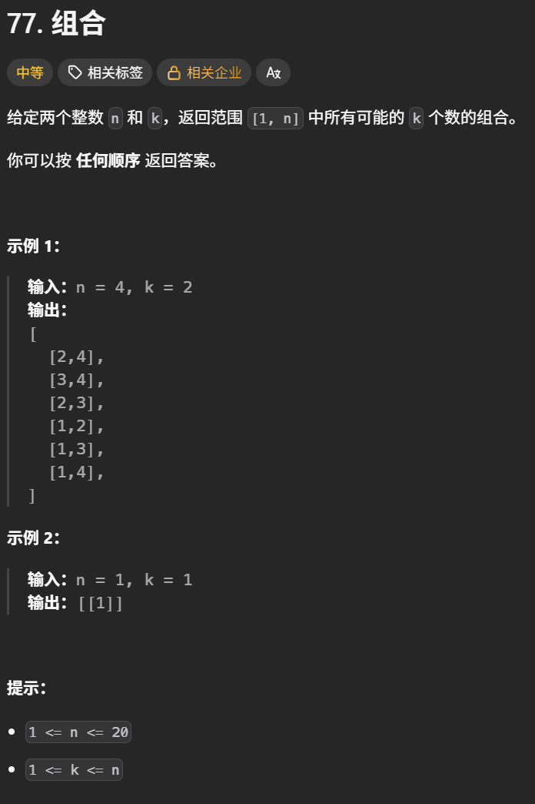
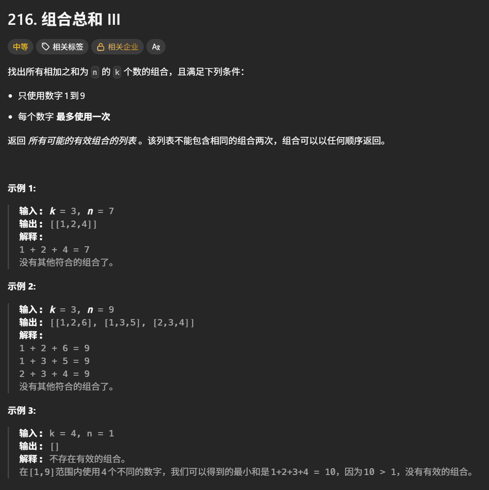
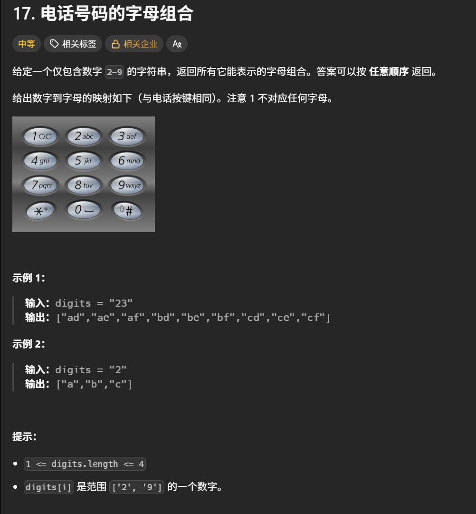
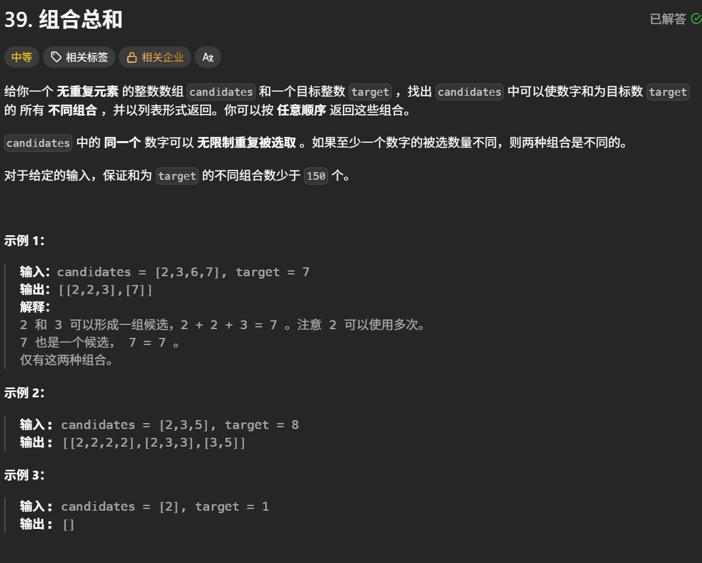
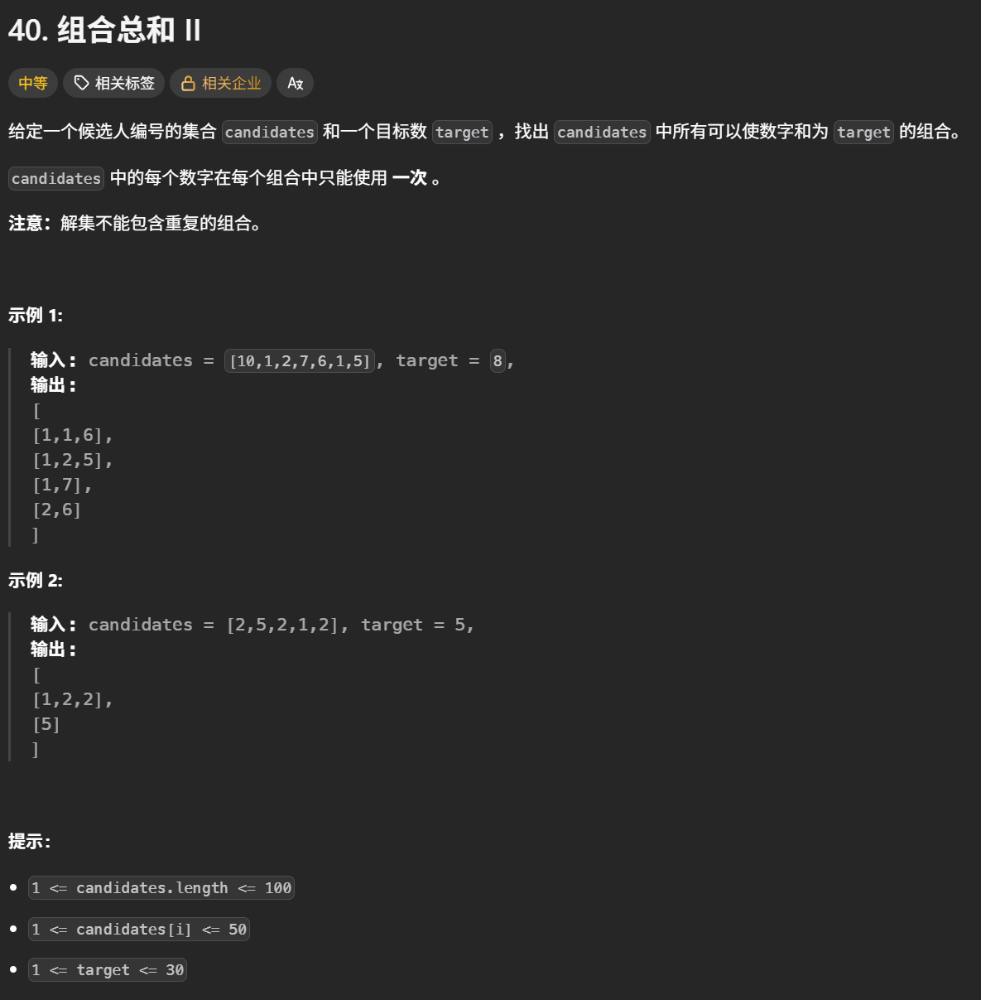

# Backtracking algorithms 学习心得

本目录用于保存回溯算法专题的实现代码，并记录解题思路、剪枝方法、易错点、边界条件和个人复盘。

## 学习内容

- [x] 回溯算法基础与递归框架
- [x] 组合问题
- [ ] 分割问题
- [ ] 子集问题
- [ ] 排列问题
- [ ] 去重与剪枝
- [ ] 棋盘问题（N皇后、解数独）
- [ ] 回溯算法综合复盘

## 核心思路

- 把问题看作一棵搜索树：每层做一次选择，递归探索，返回时撤销选择。
- 先明确递归参数、终止条件和单层搜索逻辑，再考虑剪枝。
- 用 `path` 保存当前选择，用 `result` 保存符合条件的答案；保存列表路径时使用 `path.copy()`。
- 组合与子集通常用 `startIndex` 控制搜索起点；排列通常用 `used` 标记当前路径中已经使用的元素。

## 易错点与边界条件

- **状态恢复**：修改路径、使用标记或棋盘后，要在递归返回时恢复，避免影响其他分支。
- **重复使用与去重**：先区分元素能否重复选取、输入是否有重复值、答案是否允许重复，再决定递归起点和去重条件。
- **终止条件**：根据题意判断何时收集答案；子集可以在每个节点收集，组合和排列通常在达到目标长度时收集。
- **剪枝前提**：只有确认后续分支不可能产生合法答案时才能剪枝，例如按和剪枝需要考虑是否存在负数。
- **边界检查**：关注空输入、单元素、重复元素、无解和目标长度超过候选数量等情况；空路径是否属于答案由题意决定。

## 复盘

> 回溯三部曲：
>
> 1.确定回溯函数返回值与参数
>
> 2.确定终止条件
>
> 3.回溯搜索的遍历过程
>
> 模板：
>
> ```
> void backtracking(参数) {
>     if (终止条件) {
>         存放结果;
>         return;
>     }
>
>     for (选择：本层集合中元素（树中节点孩子的数量就是集合的大小）) {
>         处理节点;
>         backtracking(路径，选择列表); // 递归
>         回溯，撤销处理结果
>     }
> }
> ```
>
>

## 代码记录

#### 组合

[组合](https://leetcode.cn/problems/combinations/description/)



```python
class Solution:
    def __init__(self):
        self.result = []
        self.path = []
    #startindex为了防止出现重复组合
    def backtracing(self , n , k , startindex):
        #回溯终止条件
        if len(self.path) == k:
            self.result.append(self.path[:])#复制当前列表，把这一刻的组合保存下来。之后修改 self.path，不会影响已经保存的组合。如果是self.path，保存的是同一个列表对象的引用。后续执行 append()、pop() 时，这个列表会变化，result 中看到的内容也会变化。
            return
        #回溯搜索的遍历过程
        for i in range(startindex , n + 1):
            self.path.append(i)
            self.backtracing(n , k , i + 1)
            self.path.pop()

    def combine(self, n: int, k: int) -> list[list[int]]:
        self.backtracing(n , k , 1)
        return self.result
```

#### 组合总和Ⅱ

[组合总和Ⅱ](https://leetcode.cn/problems/combination-sum-iii/description/)



```python
class Solution:
    def __init__(self):
        self.result = []
        self.path = []
    def backtracing(self , n , k , startindex):
        #终止条件
        if len(self.path) == k:
            if n == 0:
                self.result.append(self.path[:])
            return
        #回溯遍历过程
        for i in range(startindex , 10):
            n -= i
            self.path.append(i)#保存当前元素
            self.backtracing(n , k , i + 1)#回溯
            n += i#必须回溯，才能让下一轮选择从相同的剩余目标和开始。
            self.path.pop()

    def combinationSum3(self, k: int, n: int) -> List[List[int]]:
        self.backtracing(n , k , 1)
        return self.result

```

#### 电话号码的字母组合

[电话号码的字母组合](https://leetcode.cn/problems/letter-combinations-of-a-phone-number/description/)



```python
class Solution:
    def __init__(self):
        self.letterMap = [
            "",     # 0
            "",     # 1
            "abc",  # 2
            "def",  # 3
            "ghi",  # 4
            "jkl",  # 5
            "mno",  # 6
            "pqrs", # 7
            "tuv",  # 8
            "wxyz"  # 9
        ]
        self.result = []
        self.path = ""
    def backtracing(self , digits , index):
        #结束条件
        if index == len(digits):
            self.result.append(self.path)
            return
        #回溯遍历过程
        nums = int(digits[index])
        letter = self.letterMap[nums]
        for i in range(len(letter)):
            self.path += letter[i]
            self.backtracing(digits , index + 1)
            self.path = self.path[:-1]#删除最后一位元素
    def letterCombinations(self, digits: str) -> list[str]:
        self.backtracing(digits , 0)
        return self.result
```

#### 组合总和

[组合总和](https://leetcode.cn/problems/combination-sum/description/)



```python
class Solution:
    def __init__(self):
        self.result = []
        self.path = []
    def backtracing(self , candidates , target , startindex):
        if target == 0:
            self.result.append(self.path[:])
            return
        if target < 0:
            return
        #单层回溯遍历过程
        for i in range(startindex , len(candidates)):
            target -= candidates[i]
            self.path.append(candidates[i])
            self.backtracing(candidates , target , i)#题目说可以重复选，所以不是下一次遍历起点不是i+1，应该是i
            target += candidates[i]
            self.path.pop()
    def combinationSum(self, candidates: list[int], target: int) -> list[list[int]]:
        self.backtracing(candidates , target , 0)
        return self.result
```

#### 组合总和Ⅱ

[组合总和Ⅱ](https://leetcode.cn/problems/combination-sum-ii/description/)



```python
class Solution:
    def __init__(self):
        self.result = []
        self.path = []
    def backtracing(self , candidates , target , startindex , used):
        if target == 0:
            self.result.append(self.path[:])
            return
        if target < 0:
            return
        #used[i - 1] == true，说明同一树枝candidates[i - 1]使用过
        #used[i - 1] == false，说明同一树层candidates[i - 1]使用过
        #要对同一树层使用过的元素进行跳过
        for i in range(startindex , len(candidates)):
            if i>0 and candidates[i] == candidates[i - 1] and used[i-1] == False:
                continue
            target -= candidates[i]
            self.path.append(candidates[i])
            used[i] = True
            self.backtracing(candidates , target , i + 1 , used)
            used[i] = False
            target += candidates[i]
            self.path.pop()

    def combinationSum2(self, candidates: list[int], target: int) -> list[list[int]]:
        used = [False] * len(candidates)
        candidates.sort()#去重需要比较相邻元素，所以首先要让相同的数字排在一起
        self.backtracing(candidates , target , 0 , used)
        return self.result
```
