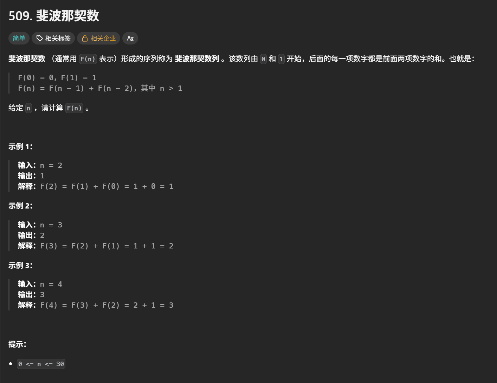
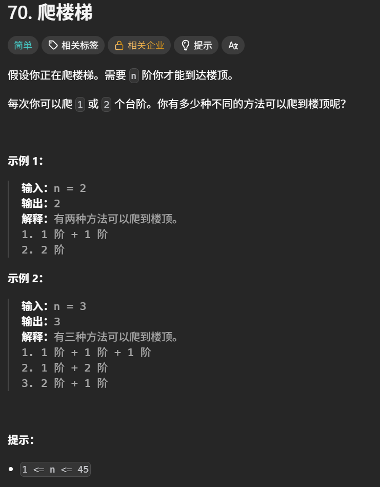
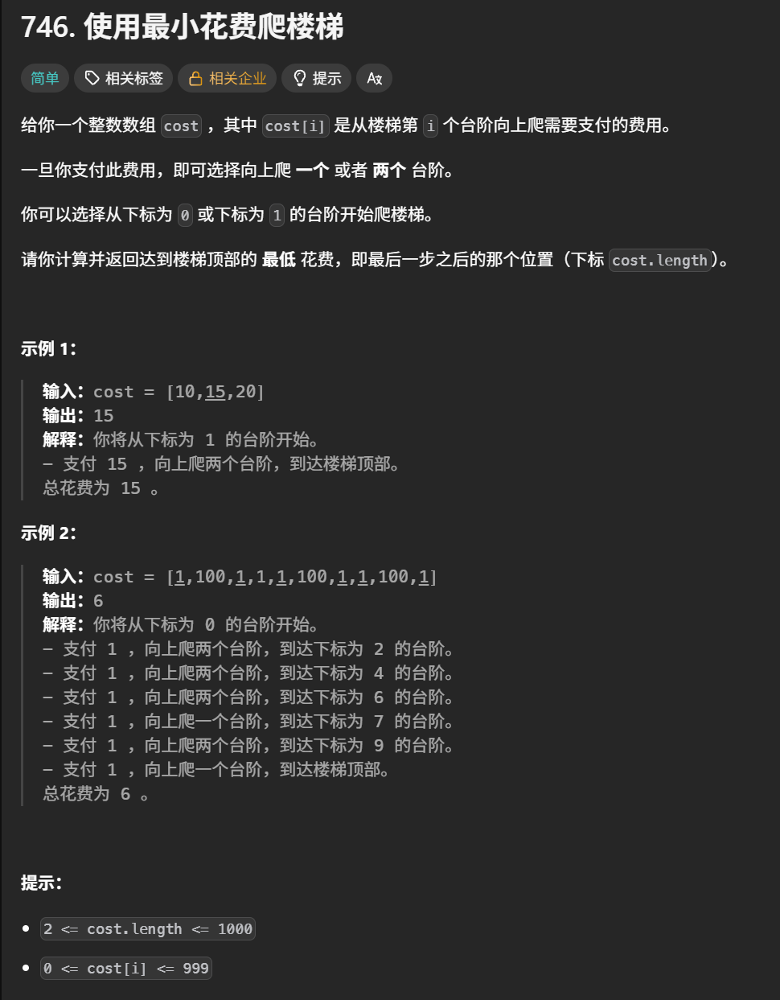

# 动态规划学习心得

本目录用于保存动态规划专题的实现代码，并记录状态定义、递推公式、初始化、遍历顺序、易错点和个人复盘。

## 学习内容

- [x] 动态规划基础与解题步骤
- [ ] 基础递推（斐波那契数、爬楼梯等）
- [ ] 路径问题（不同路径等）
- [ ] 01背包与完全背包
- [ ] 打家劫舍问题
- [ ] 股票买卖问题
- [ ] 子序列与子串问题
- [ ] 状态压缩与空间优化
- [ ] 动态规划综合复盘

## 核心思路

1. 明确 `dp` 数组及下标的含义，说明每个状态代表什么。
2. 根据状态之间的依赖关系推导递推公式。
3. 确定初始状态，以及不可达状态的表示方式。
4. 确定遍历顺序，保证计算当前状态时所需的状态已经得到。
5. 用小样例手动推导 `dp` 的变化，核对最终答案的位置。

## 易错点与边界条件

- **状态含义一致**：区分“前 i 个元素”和“以下标 i 结尾”，避免递推公式与答案位置不匹配。
- **初始化不能套用**：求方案数、最大值、最小值和可行性时，初值不同；尤其要区分“恰好装满”和“容量不超过上限”。
- **遍历顺序影响结果**：一维01背包通常倒序遍历容量，避免重复选同一物品；一维完全背包通常正序遍历容量，允许重复选取。计数题还要区分组合与排列，依据状态含义决定内外层循环。
- **空间压缩前先理清依赖**：滚动数组会覆盖旧值，更新前确认需要的是上一轮还是本轮状态，必要时用临时变量保存。
- **子序列与子串不同**：子序列允许不连续，子串要求连续，不能直接复用同一递推公式。
- **边界检查**：按题目约束检查空输入、单元素、容量或目标为0、无解、障碍及全负数等情况，避免越界或将不可达状态当成有效答案。
- **Python二维数组**：使用 `[[0] * cols for _ in range(rows)]` 初始化，避免 `[[0] * cols] * rows` 造成多行引用同一列表。

## 复盘

> 后续根据每道题的注释和笔记，总结状态定义、递推公式、初始化、遍历顺序和实际遇到的问题，并记录时间与空间复杂度。

## 代码记录

#### 斐波那契数

[斐波那契数](https://leetcode.cn/problems/fibonacci-number/description/)



```python
class Solution:
    def fib(self, n: int) -> int:
        #排除个例
        if n <=1:return n
        #创建dp数组
        dp = [0 , 1]
        ## 遍历顺序: 由前向后。因为后面要用到前面的状态
        for i in range(2 , n+1):
            total = dp[1] + dp[0]
            dp[0] = dp[1]
            dp[1] = total
        return dp[1]
```

#### 爬楼梯

[爬楼梯](https://leetcode.cn/problems/climbing-stairs/description/)



```python
class Solution:
    def climbStairs(self, n: int) -> int:
        if n <= 1:return n
        dp = [0] * (n + 1)
        dp[1] = 1
        dp[2] = 2
        for i in range(3 , n + 1):
            dp[i] = dp[i - 1] + dp[i - 2]
        return dp[n]
```

#### 使用最小花费爬楼梯

[使用最小花费爬楼梯](https://leetcode.cn/problems/min-cost-climbing-stairs/description/)



```python
class Solution:
    def minCostClimbingStairs(self, cost: list[int]) -> int:
        #初始化dp数组
        dp = [0] * (len(cost) + 1)
        dp[0] = 0
        dp[1] = 0#初始起点不花费体力值
        for i in range(2 , len(cost) + 1):
            dp[i] = min(dp[i - 1] + cost[i - 1] , dp[i - 2] + cost[i - 2])
        return dp[len(cost)]
```
