# 动态规划学习心得

本目录用于保存动态规划专题的实现代码，并记录状态定义、递推公式、初始化、遍历顺序、易错点和个人复盘。

## 学习内容

- [x] 动态规划基础与解题步骤
- [x] 基础递推（斐波那契数、爬楼梯等）
- [x] 路径问题（不同路径等）
- [x] 01背包与完全背包
- [x] 打家劫舍问题
- [x] 股票买卖问题
- [ ] 子序列与子串问题
- [ ] 状态压缩与空间优化
- [ ] 动态规划综合复盘

## 核心思路

1. 明确 `dp` 数组及下标的含义，说明每个状态代表什么。
2. 根据状态之间的依赖关系推导递推公式。
3. 确定初始状态，以及不可达状态的表示方式。
4. 确定遍历顺序，保证计算当前状态时所需的状态已经得到。
5. 用小样例手动推导 `dp` 的变化，核对最终答案的位置。

## 易错点与边界条件

- **状态含义一致**：区分“前 i 个元素”和“以下标 i 结尾”，避免递推公式与答案位置不匹配。
- **初始化不能套用**：求方案数、最大值、最小值和可行性时，初值不同；尤其要区分“恰好装满”和“容量不超过上限”。
- **遍历顺序影响结果**：一维01背包通常倒序遍历容量，避免重复选同一物品；一维完全背包通常正序遍历容量，允许重复选取。计数题还要区分组合与排列，依据状态含义决定内外层循环。
- **空间压缩前先理清依赖**：滚动数组会覆盖旧值，更新前确认需要的是上一轮还是本轮状态，必要时用临时变量保存。
- **子序列与子串不同**：子序列允许不连续，子串要求连续，不能直接复用同一递推公式。
- **边界检查**：按题目约束检查空输入、单元素、容量或目标为0、无解、障碍及全负数等情况，避免越界或将不可达状态当成有效答案。
- **Python二维数组**：使用 `[[0] * cols for _ in range(rows)]` 初始化，避免 `[[0] * cols] * rows` 造成多行引用同一列表。

## 复盘

> 后续根据每道题的注释和笔记，总结状态定义、递推公式、初始化、遍历顺序和实际遇到的问题，并记录时间与空间复杂度。

## 代码记录

#### 斐波那契数

[斐波那契数](https://leetcode.cn/problems/fibonacci-number/description/)

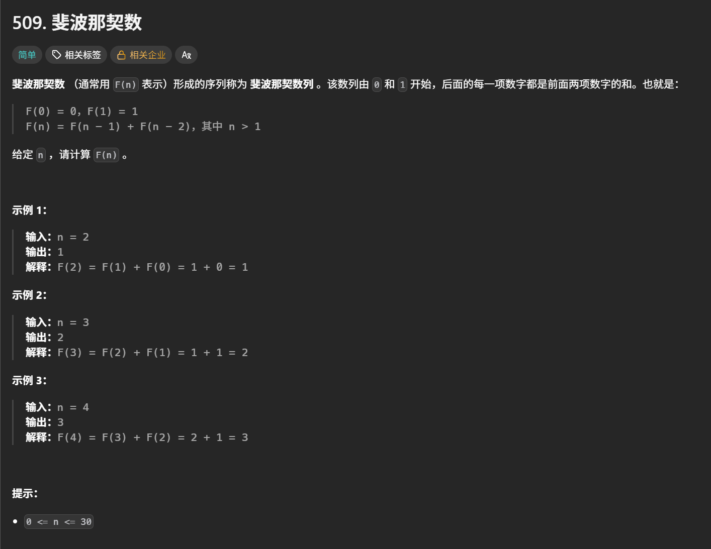

```python
class Solution:
    def fib(self, n: int) -> int:
        #排除个例
        if n <=1:return n
        #创建dp数组
        dp = [0 , 1]
        ## 遍历顺序: 由前向后。因为后面要用到前面的状态
        for i in range(2 , n+1):
            total = dp[1] + dp[0]
            dp[0] = dp[1]
            dp[1] = total
        return dp[1]
```

#### 爬楼梯

[爬楼梯](https://leetcode.cn/problems/climbing-stairs/description/)

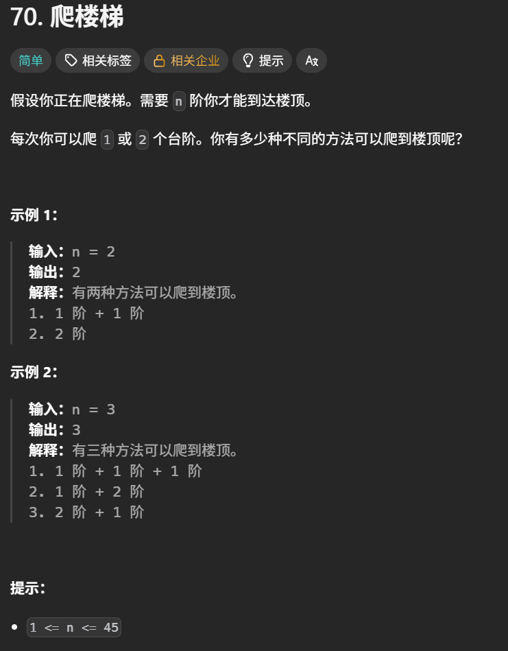

```python
class Solution:
    def climbStairs(self, n: int) -> int:
        if n <= 1:return n
        dp = [0] * (n + 1)
        dp[1] = 1
        dp[2] = 2
        for i in range(3 , n + 1):
            dp[i] = dp[i - 1] + dp[i - 2]
        return dp[n]
```

#### 使用最小花费爬楼梯

[使用最小花费爬楼梯](https://leetcode.cn/problems/min-cost-climbing-stairs/description/)

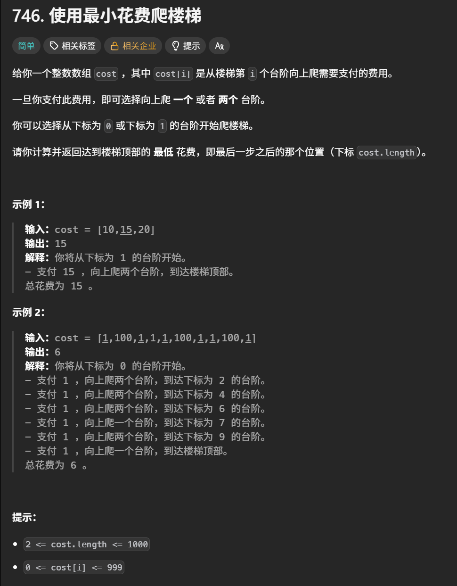

```python
class Solution:
    def minCostClimbingStairs(self, cost: list[int]) -> int:
        #初始化dp数组
        dp = [0] * (len(cost) + 1)
        dp[0] = 0
        dp[1] = 0#初始起点不花费体力值
        for i in range(2 , len(cost) + 1):
            dp[i] = min(dp[i - 1] + cost[i - 1] , dp[i - 2] + cost[i - 2])
        return dp[len(cost)]
```

  #### 不同路径

[不同路径](https://leetcode.cn/problems/unique-paths/description/)


```python
class Solution:
    def uniquePaths(self, m: int, n: int) -> int:
        #初始化二维数组
        dp = [[0] * n for _ in range(m)]
        #第一行第一列设为1
        for i in range(n):
            dp[0][i] = 1
        for j in range(m):
            dp[j][0] = 1
        #计算每个单元格的路径数
        for i in range(1 , m):
            for j in range(1 , n):
                dp[i][j] = dp[i-1][j] + dp[i][j-1]
        return dp[m-1][n-1]
```

#### 不同路径Ⅱ

[不同路径Ⅱ](https://leetcode.cn/problems/unique-paths-ii/description/)

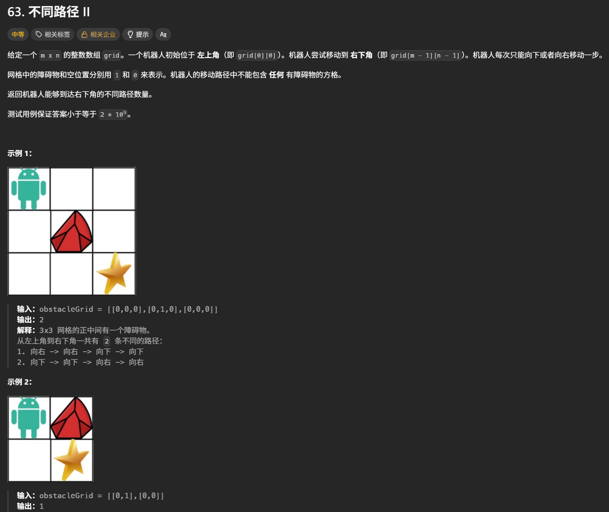

```python
class Solution:
    def uniquePathsWithObstacles(self, obstacleGrid: list[list[int]]) -> int:
        #获取棋盘大小
        m = len(obstacleGrid)#行
        n = len(obstacleGrid[0])#列
        #初始化dp数组
        dp = [[0] * n for _ in range(m)]
        #初始化第一行第一列
        for i in range(n):
            if obstacleGrid[0][i] == 1 :
                break
            else:
                dp[0][i] = 1
        for j in range(m):
            if obstacleGrid[j][0] == 1:
                break
            else:
                dp[j][0] = 1
        #遍历棋盘
        for i in range(1 , m):
            for j in range(1 , n):
                if obstacleGrid[i][j] == 1:
                    continue
                else:
                    dp[i][j] = dp[i - 1][j] + dp[i][j - 1]
        return dp[m-1][n-1]
```

#### 整数拆分

[整数拆分](https://leetcode.cn/problems/integer-break/description/)

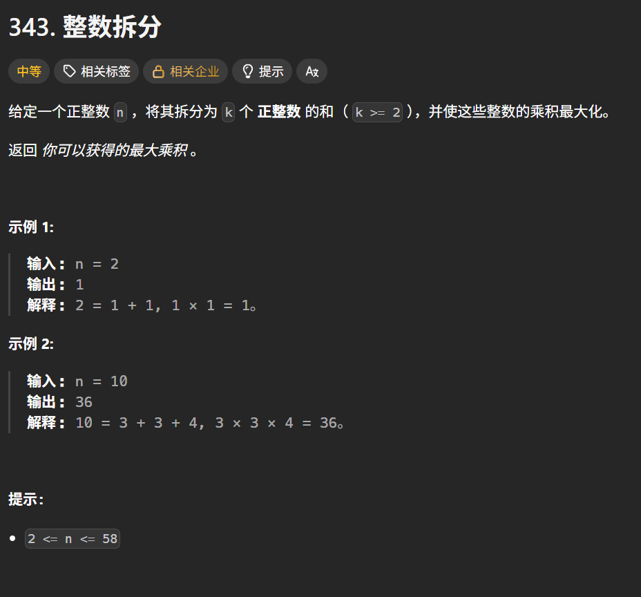

```python
class Solution:
    def integerBreak(self, n: int) -> int:
        # 假设对正整数 i 拆分出的第一个正整数是 j（1 <= j < i），则有以下两种方案：
        # 1) 将 i 拆分成 j 和 i−j 的和，且 i−j 不再拆分成多个正整数，此时的乘积是 j * (i-j)
        # 2) 将 i 拆分成 j 和 i−j 的和，且 i−j 继续拆分成多个正整数，此时的乘积是 j * dp[i-j]
        dp = [0] * (n + 1)#dp[i] 表示“整数 i 拆分后能得到的最大乘积”，所以必须能访问到 dp[n],python数组下标从0开始，所以要定义dp数组长度为n+1
        dp[2] = 1
        for i in range(3 , n + 1):
            for j in range(1 , n // 2 + 1):
                dp[i] = max(dp[i] , j * (i - j) , j * dp[i - j])
        return dp[n]

```

#### 不同的二叉搜索树

[不同的二叉搜索树](https://leetcode.cn/problems/unique-binary-search-trees/description/)

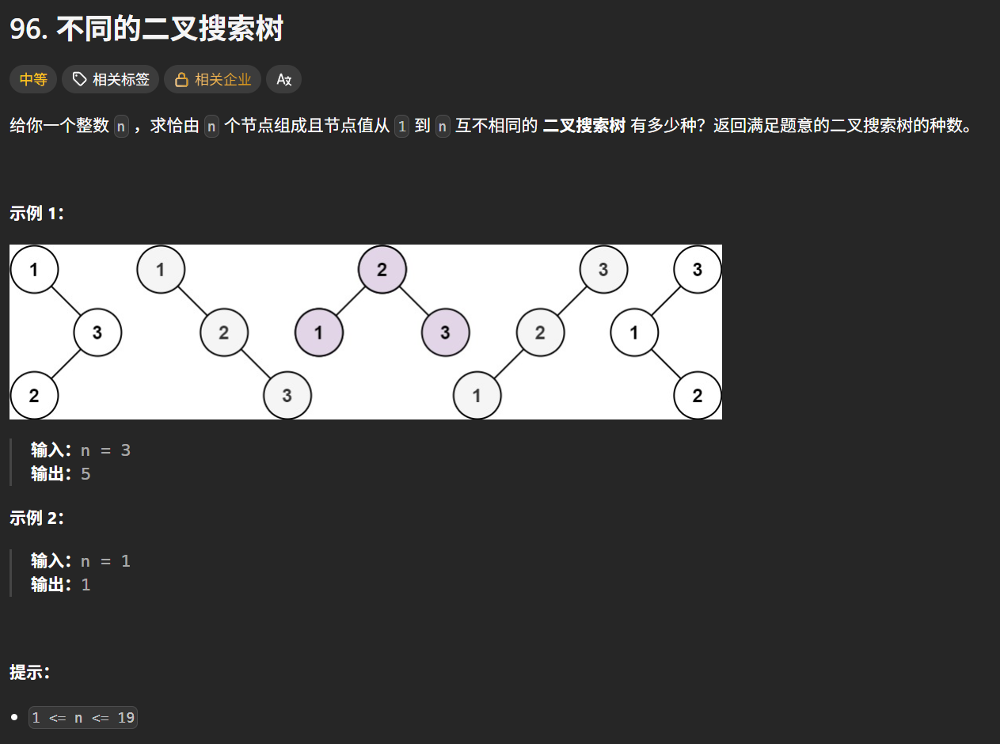

```python
class Solution:
    def numTrees(self, n: int) -> int:
        dp = [0] * (n + 1)
        dp[0] = 1
        for i in range(1 , n+1):
            for j in range(1 , i + 1):
                dp[i] += dp[j - 1] * dp[i - j]#j - 1是以j为头节点的左子树的节点数量，i-j是以j为头节点的右子树的节点数量
        return dp[n]
```

#### 背包理论基础一

[背包理论基础一](https://kamacoder.com/problempage.php?pid=1046)

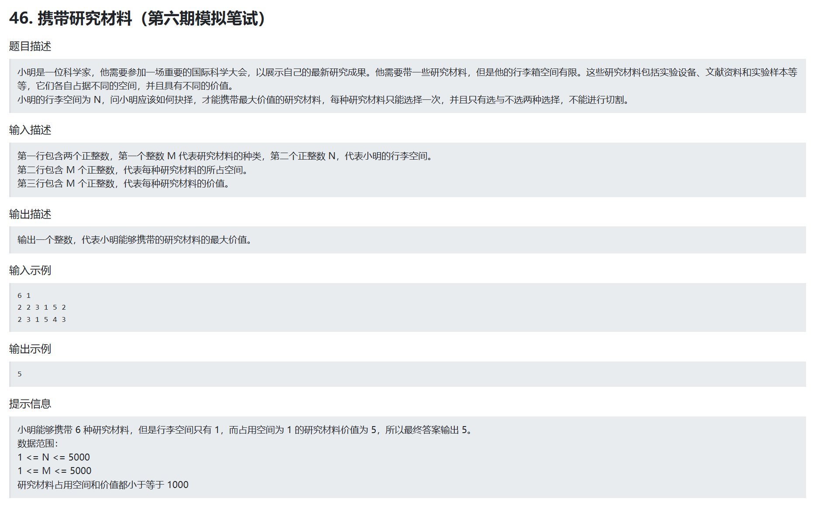

```python
n, bagweight = map(int, input().split())

weight = list(map(int, input().split()))
value = list(map(int, input().split()))

dp = [[0] * (bagweight + 1) for _ in range(n)]
for i in range(weight[0] , bagweight + 1):#从物品0的重量开始遍历到书包的重量结束
    dp[0][i] = value[0]

for i in range(1 , n):
    for j in range(bagweight + 1):#从重量0开始遍历到书包重量结束
        if j < weight[i]:#如果小于物品i的重量，那么此时书包的价值是上一个物品使用此重量书包的价值
            dp[i][j] = dp[i-1][j]
        else:
            dp[i][j] = max(dp[i-1][j] , dp[i-1][j - weight[i]] + value[i])
print(dp[n - 1][bagweight])

```

#### 分割等和子集

[分割等和子集](https://leetcode.cn/problems/partition-equal-subset-sum/description/)

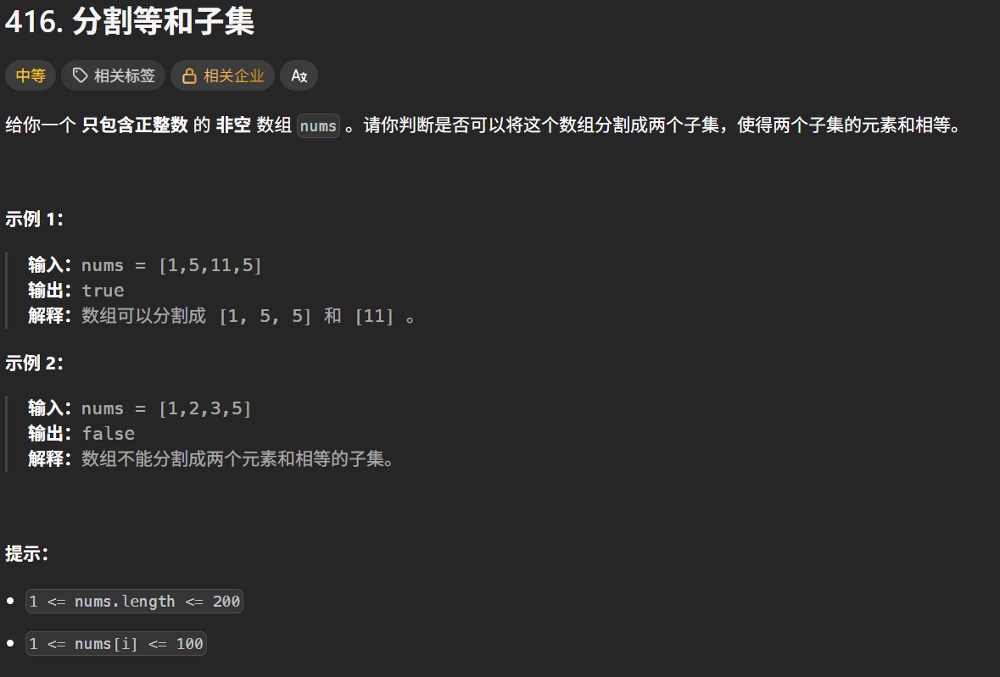

```python
class Solution:
    def canPartition(self, nums: List[int]) -> bool:
        #物品是nums[i]，重量是nums[i]，价值也是nums[i]，背包体积是sum/2
        total_sum = sum(nums)
        if total_sum % 2 != 0: return False#nums的总和必须是2的倍数
        target = total_sum // 2
        dp = [0] * (target + 1)
        for i in nums:
            for j in range(target , i -1 , -1):
                dp[j] = max(dp[j] , dp[j - i] + i)
        return dp[-1] == target
```

#### 最后一块石头的重量Ⅱ

[最后一块石头的重量Ⅱ](https://leetcode.cn/problems/last-stone-weight-ii/description/)

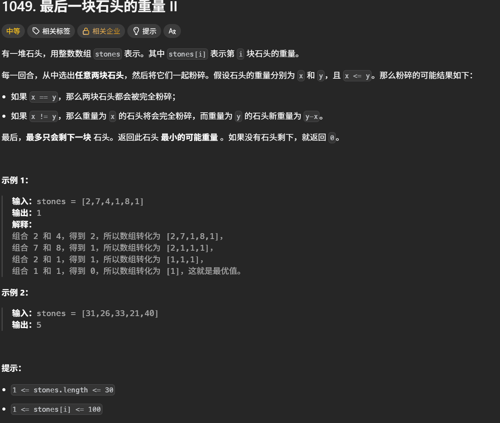

```python
class Solution:
    def lastStoneWeightII(self, stones: list[int]) -> int:
        dp = [0] * 15000
        total_sum = sum(stones)
        target = total_sum // 2
        for i in stones:
            for j in range(target , i - 1, -1):#i-1是为了让j可以取到i
                dp[j] = max(dp[j] , dp[j - i] + i)
        return total_sum - 2*dp[target]
```

#### 目标和

[目标和](https://leetcode.cn/problems/target-sum/description/)

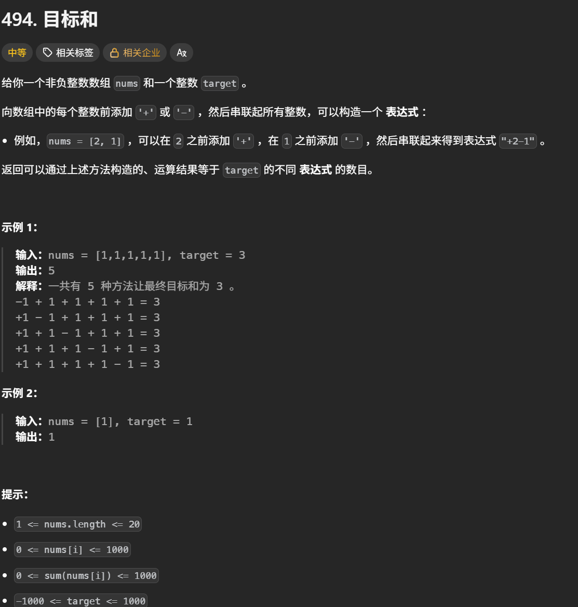

```python
class Solution:
    def findTargetSumWays(self, nums: list[int], target: int) -> int:
        total_sum = sum(nums)
        if total_sum < abs(target):
            return 0
        if (total_sum + target) % 2 != 0:
            return 0
        #目标和
        target_sum = (total_sum + target) // 2
        dp = [0] * (target_sum + 1)
        dp[0] = 1
        for i in nums:
            for j in range(target_sum , i - 1 , -1):
                dp[j] += dp[j-i]
        return dp[target_sum]
```

#### 一和零

[一和零](https://leetcode.cn/problems/ones-and-zeroes/)

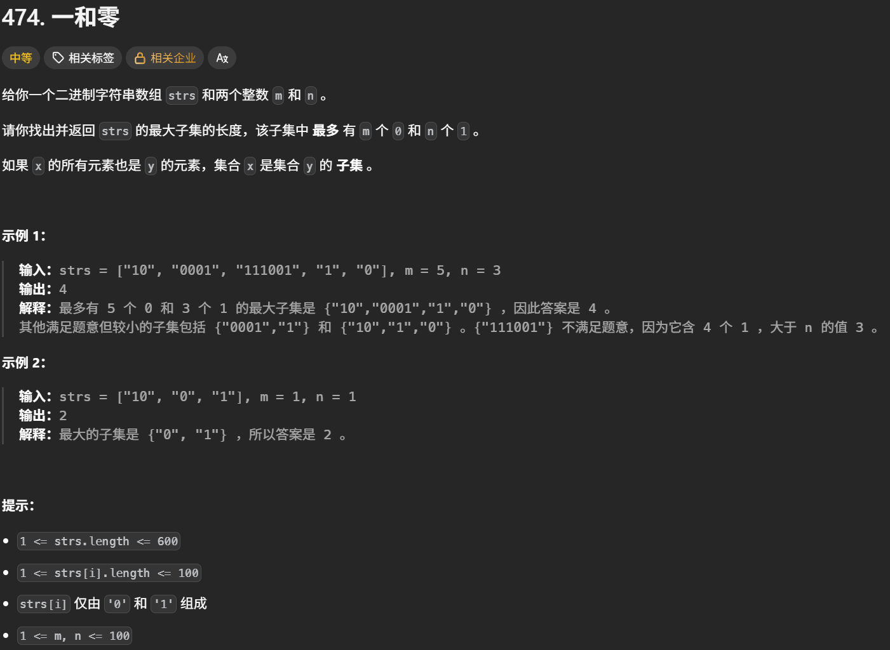

```python
class Solution:
    def findMaxForm(self, strs: List[str], m: int, n: int) -> int:
        dp = [[0] * (n + 1) for _ in range(m+1)]
        #统计0、1个数
        for s in strs:
            zeroNum = s.count('0')
            oneNum = len(s) - zeroNum
            for i in range(m , zeroNum - 1 , -1):
                for j in range(n , oneNum - 1 , -1):
                    dp[i][j] = max(dp[i][j] , dp[i - zeroNum][j - oneNum] + 1)
        return dp[m][n]
```

#### 完全背包

[完全背包](https://kamacoder.com/problempage.php?pid=1052)

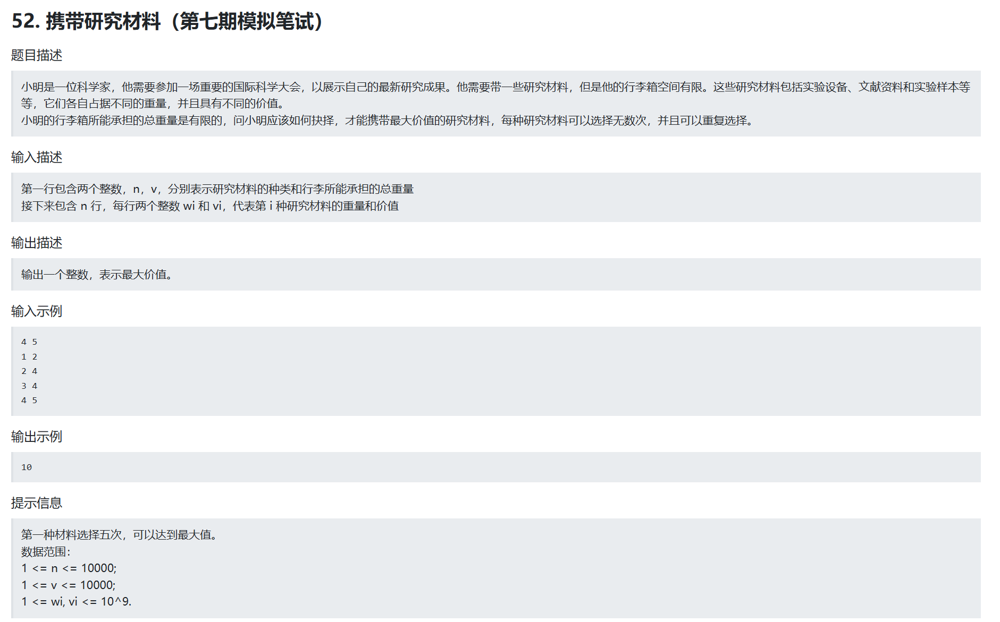

```python
def knapsack(n, bag_weight, weight, value):
    dp = [[0] * (bag_weight + 1) for _ in range(n)]#背包重量加1是要把重量为0考虑进去
    #初始化dp数组
    for j in range(weight[0] , bag_weight + 1):
        dp[0][j] = dp[0][j - weight[0]]+value[0]#dp数组第一行只要还能加物品0，就继续加
    #动态规划,先遍历物品种类，再遍历背包重量
    for i in range(1 , n):
        for j in range(bag_weight + 1):
            if j < weight[i]:dp[i][j] = dp[i-1][j]
            else:
                dp[i][j] = max(dp[i-1][j] , dp[i][j - weight[i]] + value[i])
    return dp[n-1][bag_weight]

#输入
n , bag_weight = map(int , input().split())
weight = []
value = []
for _ in range(n):
    w , v = map(int , input().split())
    weight.append(w)
    value.append(v)
print(knapsack(n , bag_weight, weight, value))
```

#### 零钱兑换Ⅱ

[零钱兑换Ⅱ](https://leetcode.cn/problems/coin-change-ii/description/)

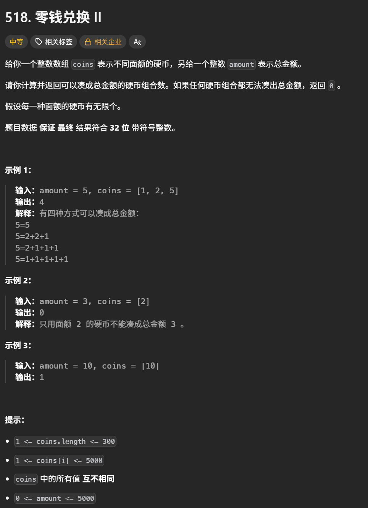

```python
class Solution:
    def change(self, amount: int, coins: list[int]) -> int:
        dp = [0] * (amount + 1)
        dp[0] = 1#背包重量为0的组合种类有1个
        #这个完全背包要考虑顺序问题，所以外层遍历种类，内层遍历背包重量
        for i in range(len(coins)):
            for j in range(coins[i] , amount + 1):#当前硬币面值是 coins[i]，只有金额 j >= coins[i] 时，才放得下这枚硬币，才能用它凑钱。
                dp[j] += dp[j - coins[i]]
        return dp[amount]
```

#### 组合总和Ⅳ

[组合总和Ⅳ](https://leetcode.cn/problems/combination-sum-iv/description/)

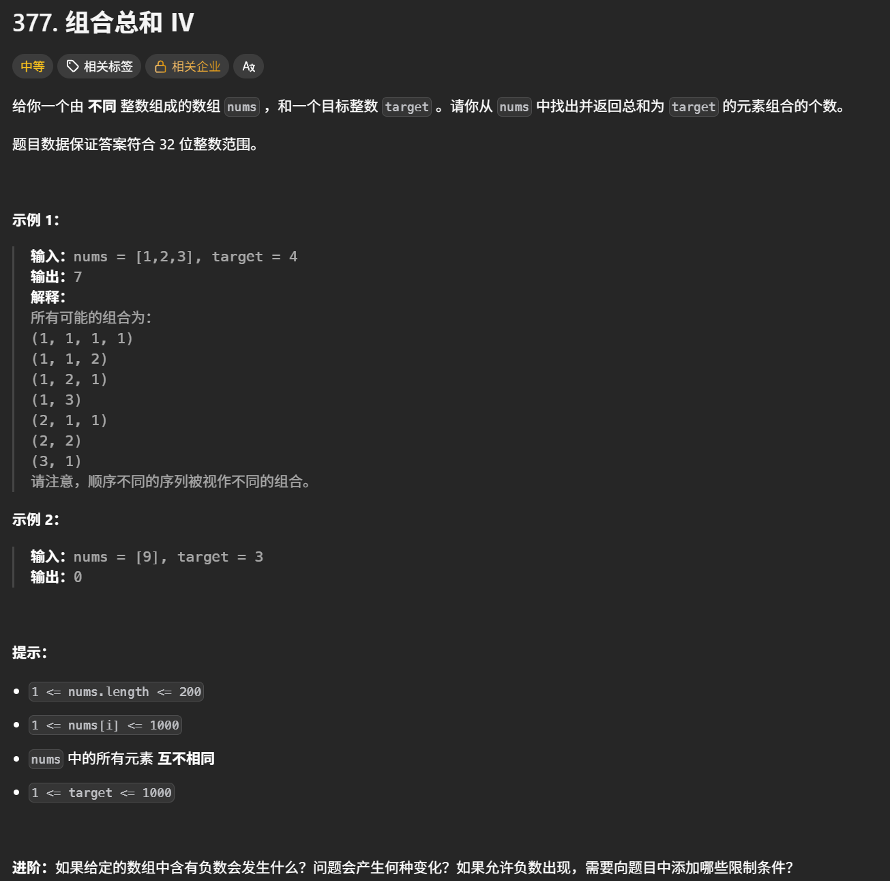

```python
class Solution:
    def combinationSum4(self, nums: list[int], target: int) -> int:
        #如果求组合数就是外层for循环遍历物品，内层for遍历背包。
        #如果求排列数就是外层for遍历背包，内层for循环遍历物品。
        dp = [0] * (target + 1)
        dp[0] = 1
        for i in range(target  + 1):
            for j in range(len(nums)):
                if i >= nums[j]:
                    dp[i] += dp[i - nums[j]]
        return dp[target]
```

#### 爬楼梯进阶版

[爬楼梯进阶版](https://kamacoder.com/problempage.php?pid=1067)

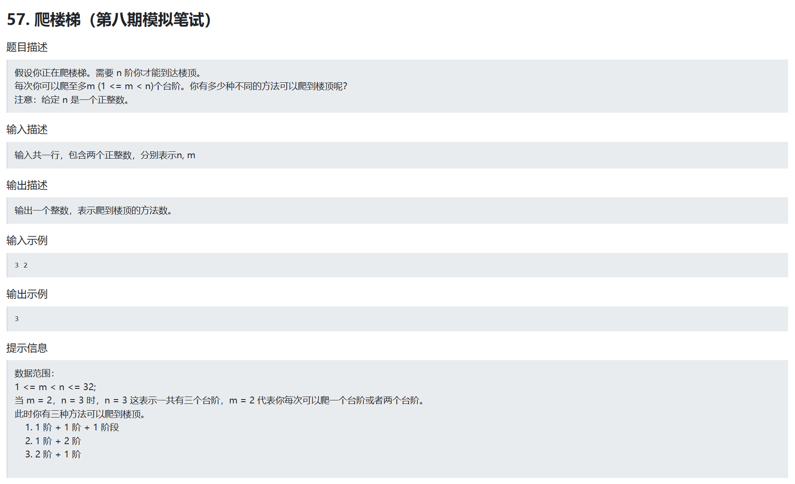

```python
def climbing_stairs(n,m):
    #背包总容量
    dp = [0] * (n + 1)
    dp[0] = 1
    #排列题
    for j in range(1 , n + 1):
        for i in range(1 , m + 1):
            if j >=  i:
                dp[j] += dp[j - i]
    return dp[n]

if __name__ == '__main__':
    n , m = list(map(int , input().split(' ')))
    print(climbing_stairs(n , m))
```

#### 零钱兑换

[零钱兑换](https://leetcode.cn/problems/coin-change/description/)

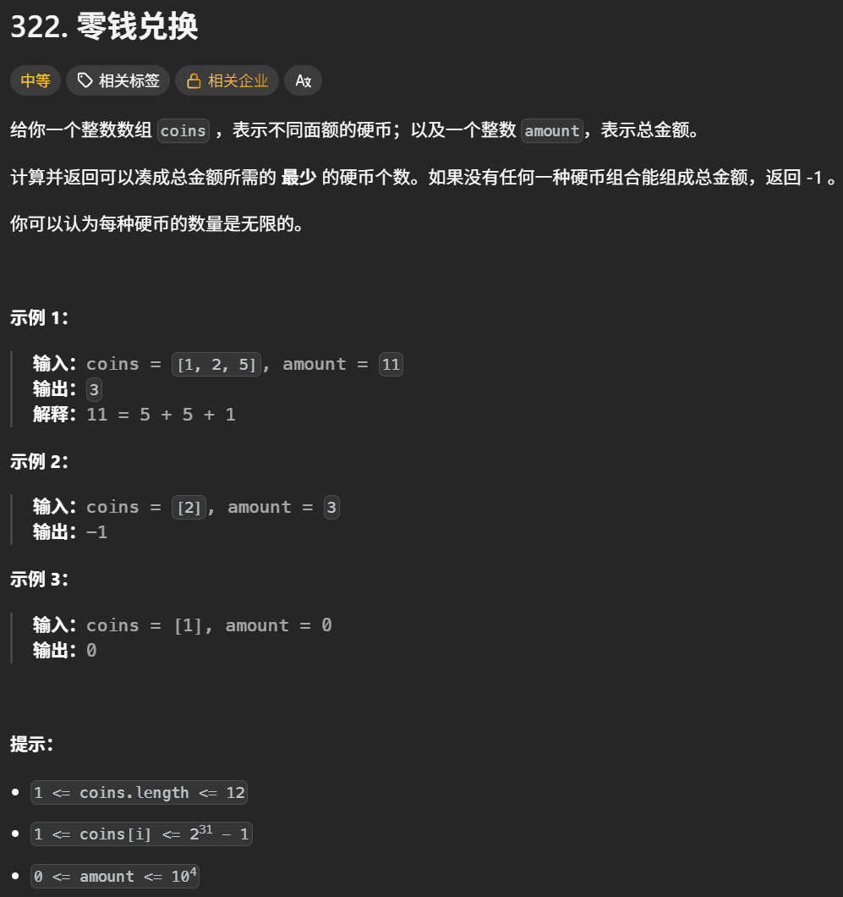

```python
class Solution:
    def coinChange(self, coins: list[int], amount: int) -> int:
        dp = [float('inf')] * (amount + 1)
        dp[0] = 0 #背包重量为0时，最小硬币数量也为0
        #先遍历物品，再遍历背包
        for i in coins:
            for j in range(i , amount + 1):
                if dp[j - i] != float('inf'):
                    dp[j] = min(dp[j] , dp[j - i] + 1)
        if dp[amount] == float('inf'):#如果背包最终的结果还是无穷大，说明无解
            return -1
        return dp[amount]
```

#### 完全平方数

[完全平方数](https://leetcode.cn/problems/perfect-squares/description/)

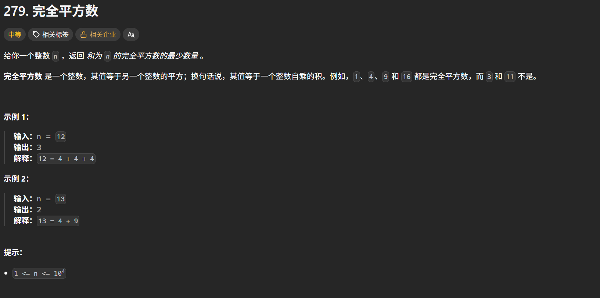

```python
class Solution:
    #n是背包重量，完全平方数是物品
    def numSquares(self, n: int) -> int:
        dp = [float('inf')] * (n + 1)
        dp[0] = 0
        #先遍历背包，再遍历物品，反之也可以，因为是完全背包求最小值
        for i in range(1 , n + 1):
            for j in range(1 , int(i ** 0.5) + 1):
                dp[i] = min(dp[i] , dp[i - j * j] + 1)
        return dp[n]
```

#### 单词拆分

[单词拆分](https://leetcode.cn/problems/word-break/description/)

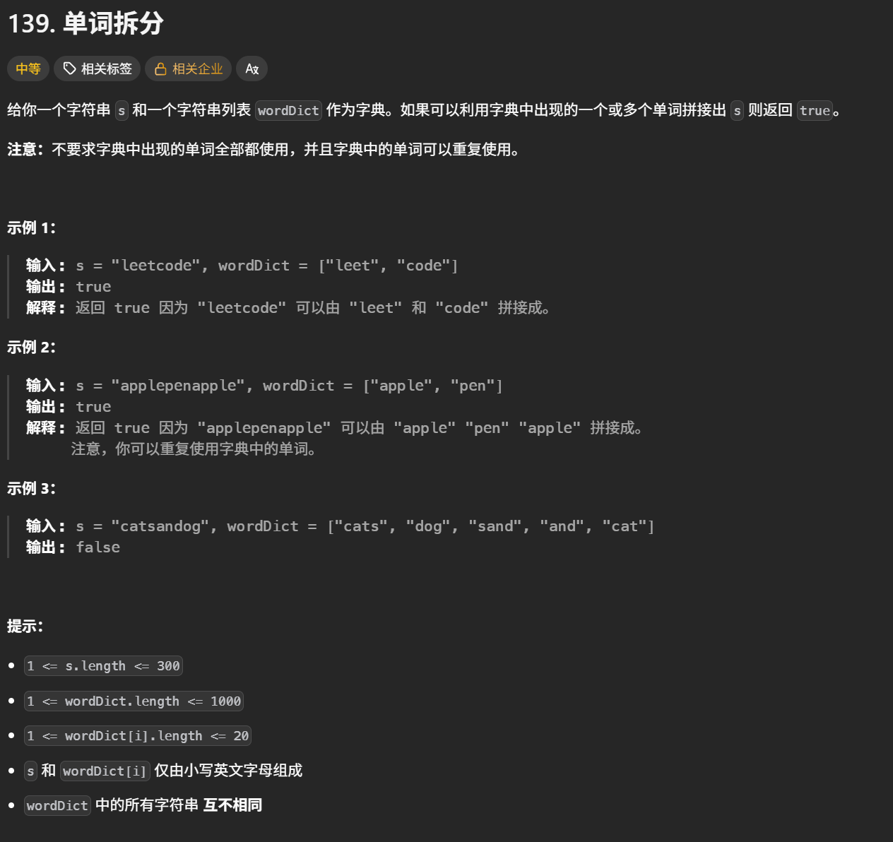

```python
class Solution:
    def wordBreak(self, s: str, wordDict: List[str]) -> bool:
        wordset = set(wordDict)#将字典转换为集合，因为集合里的元素不重复，可以快速判断单词有没有出现在集合里
        n = len(s)
        dp = [False] * (n + 1)
        dp[0] = True #空字符可以被拆分成单词
        #先遍历背包，再遍历物品
        for i in range(1 , n + 1):
            for j in range(i):
                if dp[j] and s[j : i] in wordset:
                    dp[i] = True
                    break
        return dp[n]
```

#### 多重背包

[多重背包](https://kamacoder.com/problempage.php?pid=1066)

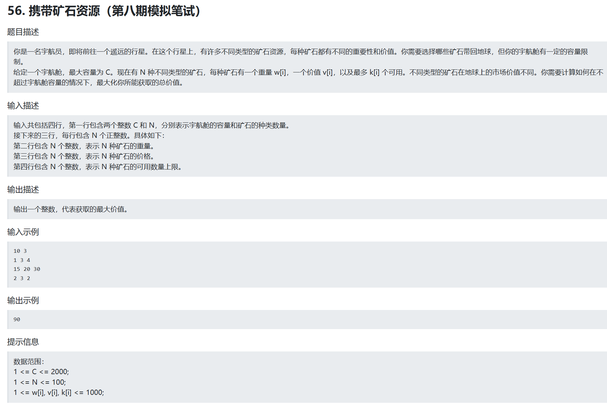

```python
#多重背包
C, N = input().split(" ")#C是背包重量 ， N是物品种类
C, N = int(C), int(N)

# value数组需要判断一下非空不然过不了
weights = [int(x) for x in input().split(" ")]
values = [int(x) for x in input().split(" ") if x]
nums = [int(x) for x in input().split(" ")]

dp = [0] * (C + 1)
#先遍历物品种类，再遍历背包重量，再遍历物品件数
for i in range(N):
    for j in range(C , weights[i] - 1 , -1):
        for k in range(1 , nums[i] + 1 ):
            if k * weights[i] > j:
                break
            dp[j] = max(dp[j] , dp[j - k * weights[i]] + values[i] * k)
print(dp[-1])
```

#### 背包问题总结


#### 打家劫舍

[打家劫舍](https://leetcode.cn/problems/house-robber/description/)

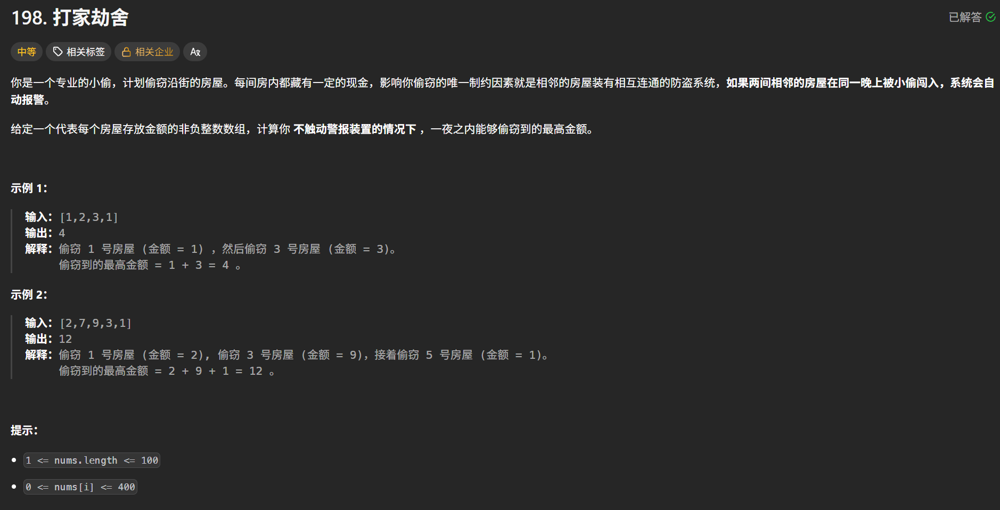

```python
class Solution:
    def rob(self, nums: List[int]) -> int:
        #如果没有房屋，返回0
        if len(nums) == 0:
            return 0
        #如果只有一间房屋，返回 nums[0]
        if len(nums) == 1:
            return nums[0]
        dp = [0] * len(nums)#这里有n个房屋，dp数据长度不用加1，因为房屋的下标是从0到n-1，一共n个房屋
        dp[0] = nums[0]
        dp[1] = max(nums[0] , nums[1])
        #从前向后遍历
        for i in range(2 , len(nums)):
            # 对于每个房屋，选择抢劫当前房屋和抢劫前一个房屋的最大金额
            dp[i] = max(dp[i-1] , dp[i-2] + nums[i])
        return dp[-1]
```

#### 打家劫舍Ⅱ

[打家劫舍Ⅱ](https://leetcode.cn/problems/house-robber-ii/description/)

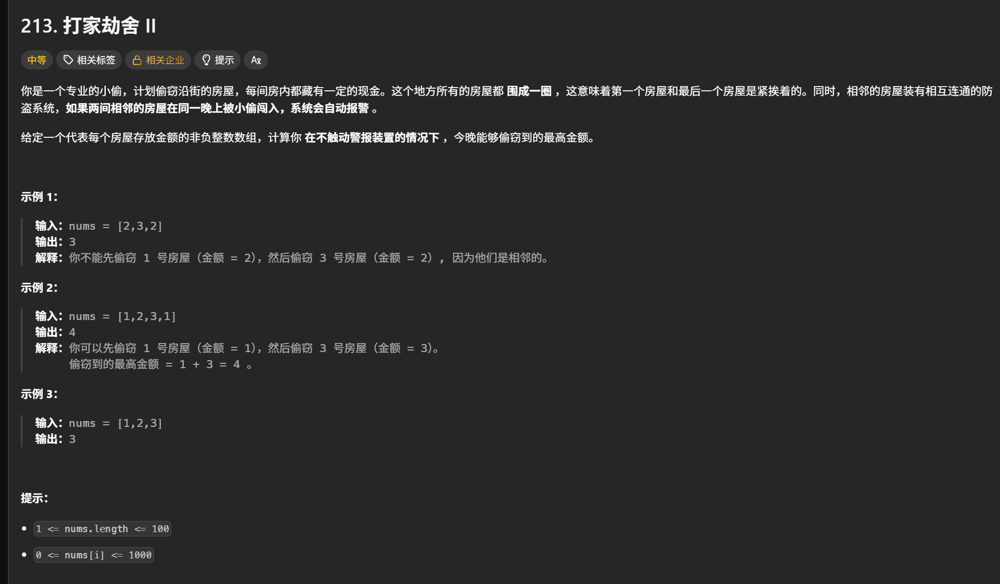

```python
class Solution:
    def rob(self, nums: list[int]) -> int:
        if len(nums) == 0:
            return 0
        if len(nums) == 1:
            return nums[0]
        #情况一，不偷最后一间
        #情况二，不偷第一间
        result1 = self.robrange(nums , 0 , len(nums) -2)
        result2 = self.robrange(nums , 1 , len(nums) -1)
        return max(result1 , result2)

    def robrange(self , nums , start , end):
        if end == start:
            return nums[start]
        pre_max = nums[start]
        cur_max = max(nums[start] , nums[start + 1])
        for i in range(start + 2, end + 1):#因为 end 是这段范围内最后一间房的下标，需要处理，所以要加1
            temp = cur_max
            cur_max = max(pre_max + nums[i] , cur_max)
            pre_max = temp
        return cur_max
```

#### 打家劫舍Ⅲ

[打家劫舍Ⅲ](https://leetcode.cn/problems/house-robber-iii/description/)

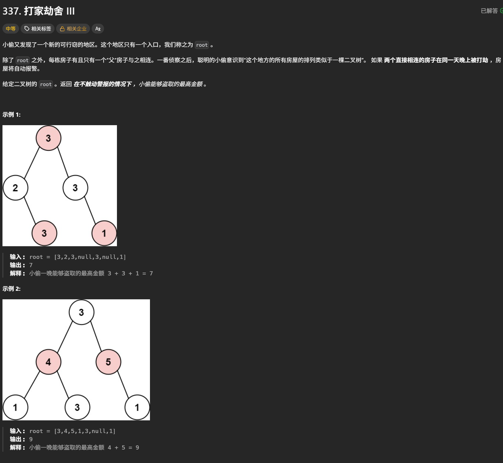

```python
class Solution:
    def rob(self, root: TreeNode | None) -> int:
        # dp数组（dp table）以及下标的含义：
        # 1. 下标为 0 记录 **不偷该节点** 所得到的的最大金钱
        # 2. 下标为 1 记录 **偷该节点** 所得到的的最大金钱
        dp = self.mydigui(root)
        return max(dp)

    # 要用后序遍历, 因为要通过递归函数的返回值来做下一步计算
    def mydigui(self , node):
        # 递归终止条件，就是遇到了空节点，那肯定是不偷的
        if not node:
            return (0 , 0)
        left = self.mydigui(node.left)
        right = self.mydigui(node.right)
        #偷当前节点
        val_0 = node.val + left[0] + right[0]
        #不偷当前节点
        val_1 = max(left[0] , left[1]) + max(right[0] , right[1])
        return (val_1 , val_0)
```

#### 买卖股票的时机

[买卖股票的时机](https://leetcode.cn/problems/best-time-to-buy-and-sell-stock/description/)

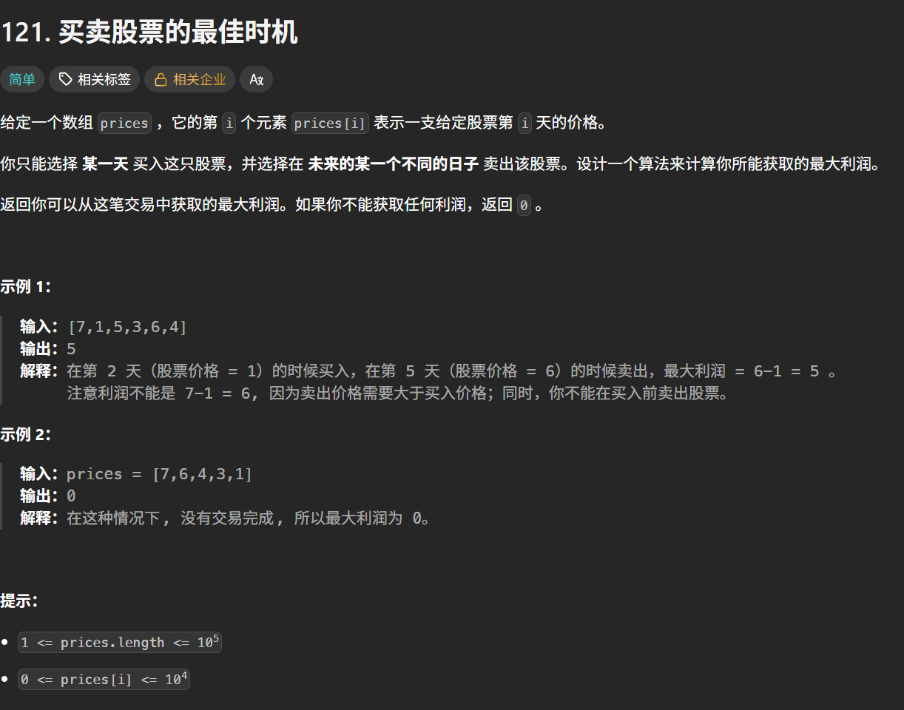

```python
class Solution:
    def maxProfit(self, prices: list[int]) -> int:
        length = len(prices)
        if length == 0:
            return 0
        dp = [[0] * 2 for _ in range(length)]
        dp[0][0] -= prices[0]
        dp[0][1] = 0
        for i in range(1 , length):
            dp[i][0] = max(dp[i - 1][0] , -prices[i])
            dp[i][1] = max(prices[i] + dp[i - 1][0] , dp[i - 1][1])
        return dp[length - 1][1]
```

#### 买卖股票的最佳时机Ⅱ

[买卖股票的最佳时机Ⅱ](https://leetcode.cn/problems/best-time-to-buy-and-sell-stock-ii/description/)

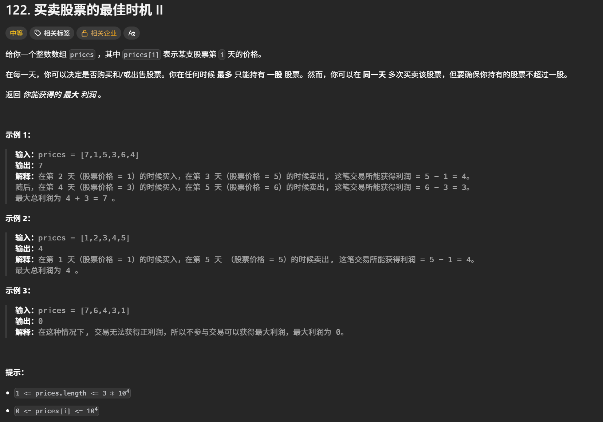

```python
class Solution:
    def maxProfit(self, prices: list[int]) -> int:
        length = len(prices)
        if length == 0:
            return 0
        dp = [[0] * 2 for _ in range(length)]
        dp[0][0] -= prices[0]
        dp[0][1] = 0
        for i in range(1 , length):
            dp[i][0] = max(dp[i - 1][0] , dp[i - 1][1] - prices[i])
            dp[i][1] = max(dp[i - 1][1] , prices[i] + dp[i - 1][0])
        return dp[length - 1][1]
```

#### 买卖股票的最佳时机Ⅲ

[买卖股票的最佳时机Ⅲ](https://leetcode.cn/problems/best-time-to-buy-and-sell-stock-iii/description/)

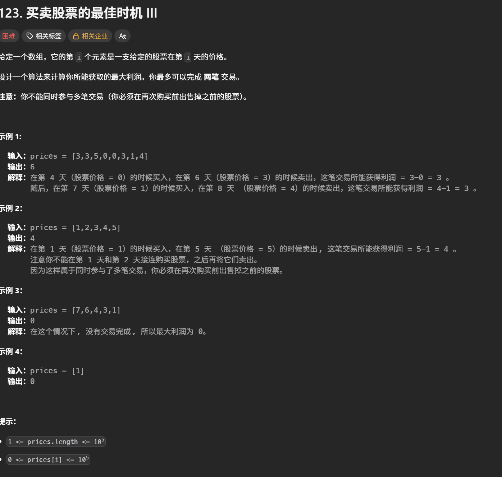

```python
class Solution:
    def maxProfit(self, prices: list[int]) -> int:
        #5种状态 0: 没有操作, 1: 第一次买入, 2: 第一次卖出, 3: 第二次买入, 4: 第二次卖出
        length = len(prices)
        if length == 0:
            return 0
        dp = [[0] * 5 for _ in range(length)]
        dp[0][1] -= prices[0]
        dp[0][3] -= prices[0]
        for i in range(1 , length):
            dp[i][0] = dp[i - 1][0]
            dp[i][1] = max(dp[i - 1][1] , dp[i - 1][0] - prices[i])
            dp[i][2] = max(dp[i - 1][2] , dp[i - 1][1] + prices[i])
            dp[i][3] = max(dp[i - 1][3] , dp[i - 1][2] - prices[i])
            dp[i][4] = max(dp[i - 1][4] , dp[i - 1][3] + prices[i])
        return dp[length - 1][4]
```

#### 买卖股票的最佳时机Ⅳ

[买卖股票的最佳时机Ⅳ](https://leetcode.cn/problems/best-time-to-buy-and-sell-stock-iv/description/)

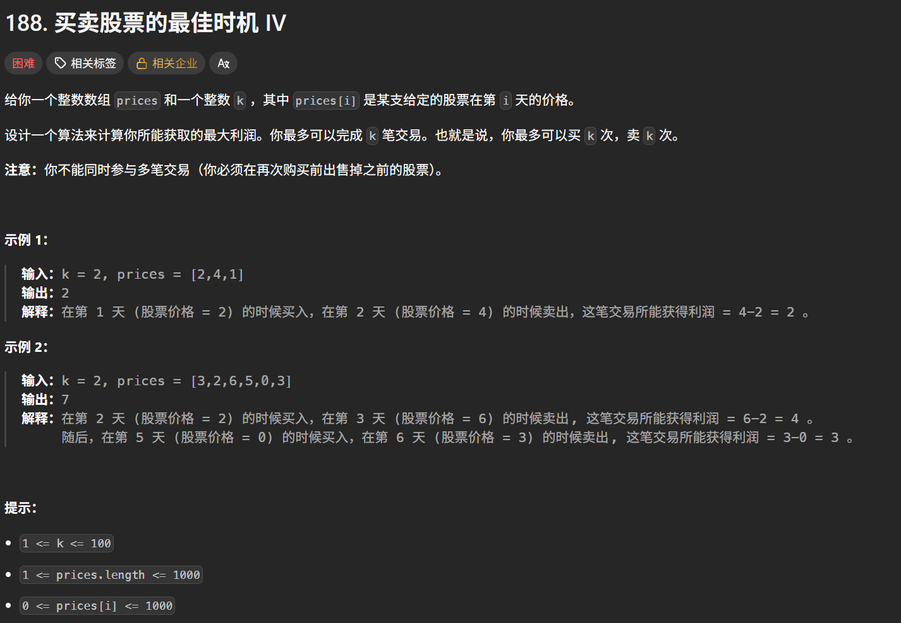

```python
class Solution:
    def maxProfit(self, k: int, prices: List[int]) -> int:
        length = len(prices)
        if length == 0:
            return 0
        dp = [[0] * (2 * k + 1) for _ in range(length)]
        #奇数操作都是买入
        for j in range(1 , 2 * k , 2):
            dp[0][j] = -prices[0]
        for i in range(1 , length):
            for j in range(0 , 2 * k - 1 , 2):
                dp[i][j + 1] = max(dp[i - 1][j + 1] , dp[i - 1][j] - prices[i])
                dp[i][j + 2] = max(dp[i - 1][j + 2] , dp[i - 1][j + 1] + prices[i])
        return dp[length - 1][2* k]
```

#### 买卖股票的最佳时机含冷冻期

[买卖股票的最佳时机含冷冻期](https://leetcode.cn/problems/best-time-to-buy-and-sell-stock-with-cooldown/description/)

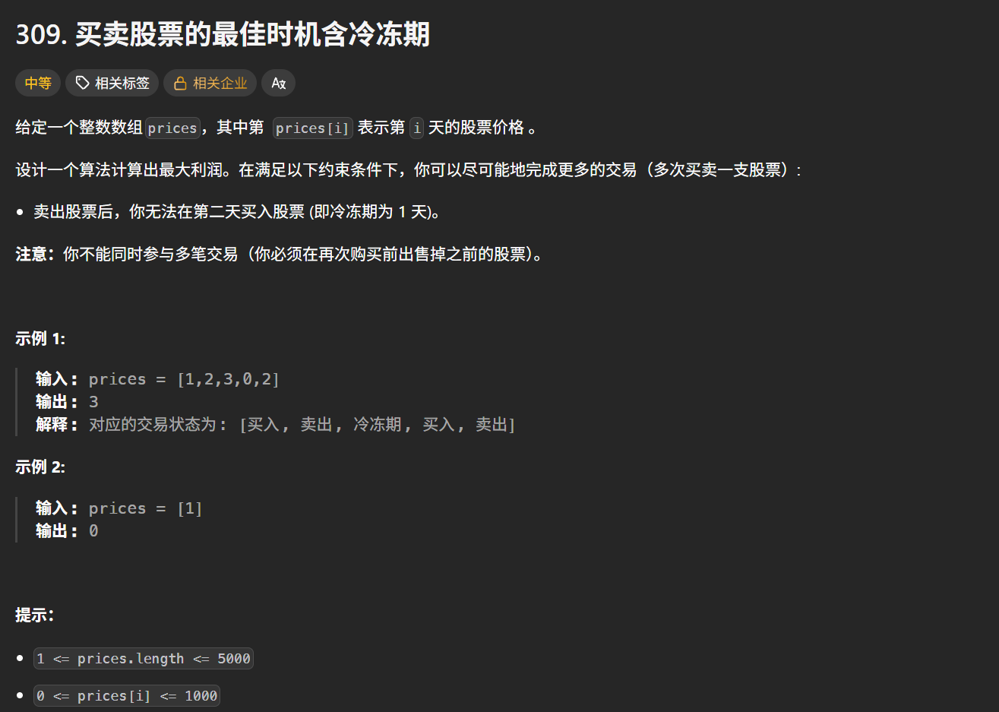

```python
class Solution:
    def maxProfit(self, prices: list[int]) -> int:
        length = len(prices)
        if length == 0:
            return 0
        #4个状态分别表示昨天就持有，或者今天买入0、昨天普通空仓，或者昨天冷冻、今天解冻后仍然没买1、昨天持股，今天卖出2、昨天卖出，今天不能买3
        dp = [[0] * 4 for _ in range(length)]
        dp[0][0] = -prices[0]
        for i in range(1 , length):
            dp[i][0] = max(dp[i - 1][0] , # 昨天持有，今天继续持有
                           dp[i - 1][3] - prices[i], # 昨天是冷冻期，今天解冻，可以买入
                           dp[i - 1][1] - prices[i])# 昨天空仓，既没卖出也不在冷冻期，今天买入
            dp[i][1] = max(dp[i - 1][1] ,
                           dp[i - 1][3])
            dp[i][2] = dp[i - 1][0] + prices[i]
            dp[i][3] = dp[i - 1][2]
        return max(dp[length - 1][3] , dp[length - 1][1] , dp[length - 1][2])
```

#### 买卖股票的最佳时机含手续费

[买卖股票的最佳时机含手续费](https://leetcode.cn/problems/best-time-to-buy-and-sell-stock-with-transaction-fee/description/)

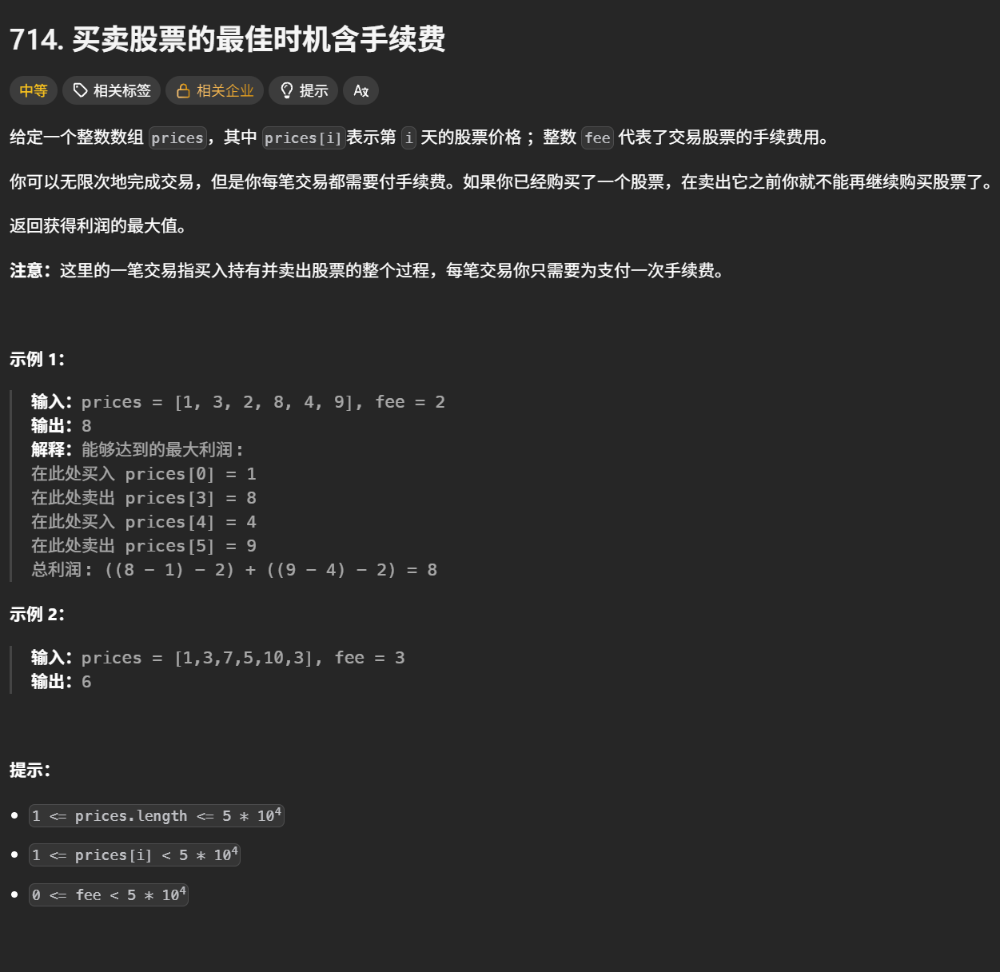

```python
class Solution:
    def maxProfit(self, prices: List[int], fee: int) -> int:
        #dp[i][0] 表示第i天持有股票所得最多现金。 dp[i][1] 表示第i天不持有股票所得最多现金
        length = len(prices)
        if length == 0:
            return 0
        dp = [[0] * 2 for _ in range(length)]
        dp[0][0] = -prices[0]
        for i in range(1 , length):
            dp[i][0] = max(dp[i - 1][0] , dp[i - 1][1] - prices[i])
            dp[i][1] = max(dp[i - 1][1] , dp[i - 1][0] + prices[i] - fee)
        return dp[length - 1][1]
```

#### 最长递增子序列

[最长递增子序列](https://leetcode.cn/problems/longest-increasing-subsequence/)

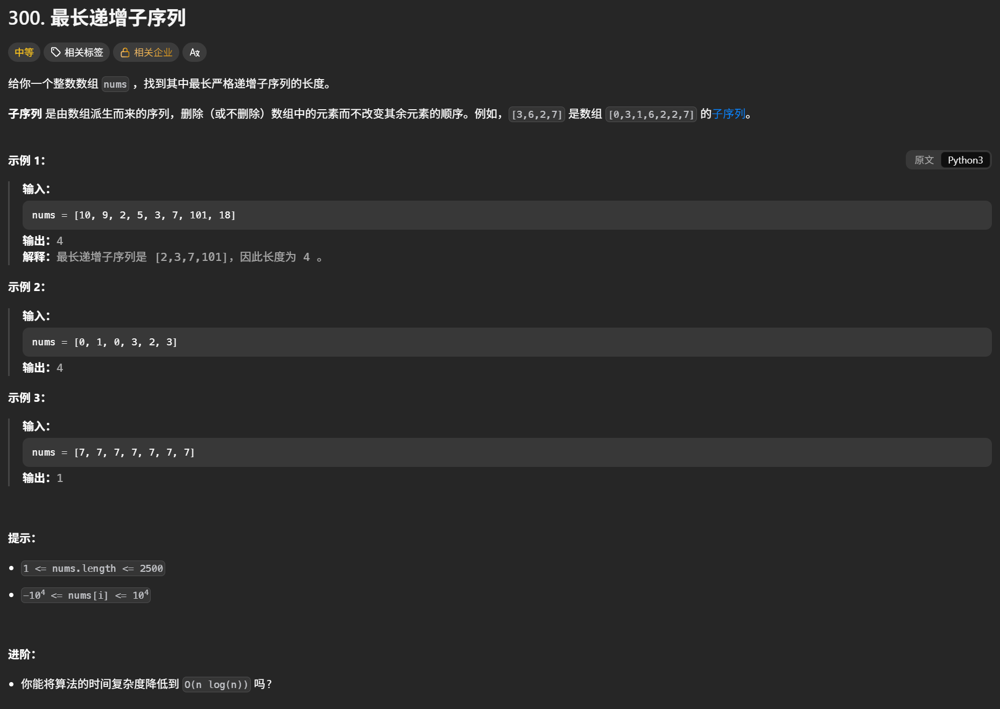

```python
class Solution:
    def lengthOfLIS(self, nums: list[int]) -> int:
        if len(nums) <= 1:
            return len(nums)
        dp = [1] * len(nums)
        result = 1
        for i in range(1 , len(nums)):
            for j in range(0 , i):
                if nums[j] < nums[i]:
                    dp[i] = max(dp[i] , dp[j] + 1)
            result = max(result , dp[i])#取最长的子序列
        return result
```

#### 最长连续递增序列

[最长连续递增序列](https://leetcode.cn/problems/longest-continuous-increasing-subsequence/description/)

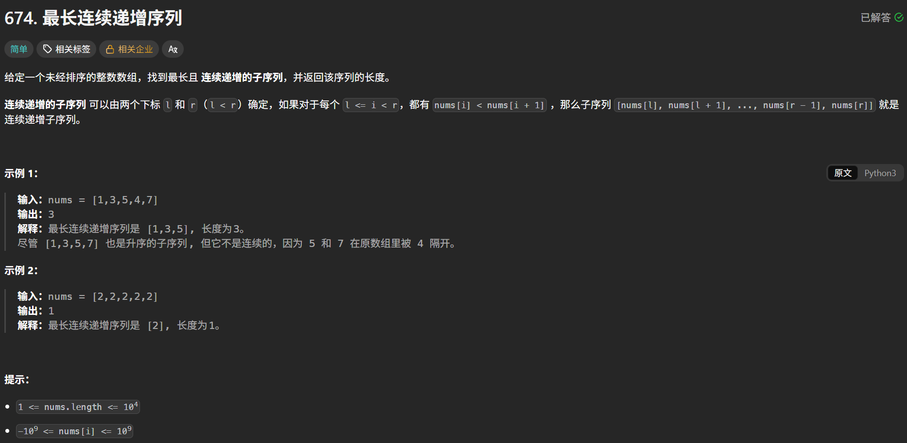

```python
class Solution:
    def findLengthOfLCIS(self, nums: list[int]) -> int:
        if len(nums) == 0:
            return 0
        result = 1
        dp = [1] * len(nums)
        for i in range(len(nums) - 1):
            if nums[i + 1] > nums[i]:
                dp[i + 1] = dp[i] + 1
            result = max(dp[i + 1] , result)
        return result
```

#### 最长重复子数组

[最长重复子数组](https://leetcode.cn/problems/maximum-length-of-repeated-subarray/description/)

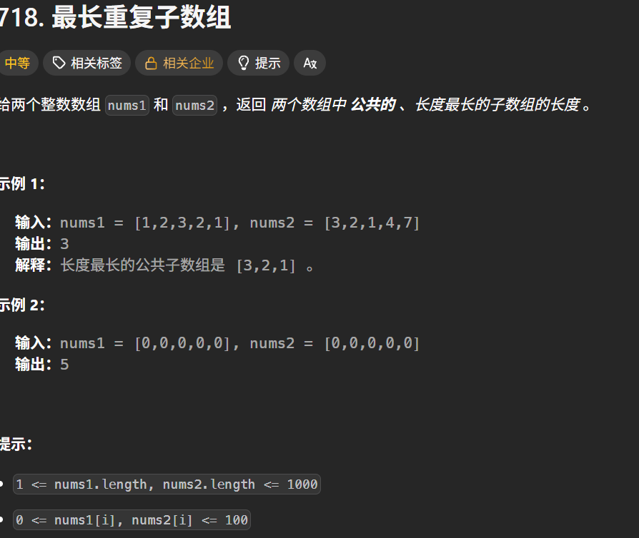

```python
class Solution:
    def findLength(self, nums1: list[int], nums2: list[int]) -> int:
        dp = [[0] * (len(nums2) + 1) for _ in range(len(nums1) + 1)]
        result = 0
        for i in range(1 , len(nums1) + 1):
            for j in range(1 , len(nums2) + 1):
                if nums1[i - 1] == nums2[j - 1]:
                    dp[i][j] = dp[i - 1][j - 1] + 1
                if dp[i][j] > result:#更新最长重复子数组的长度
                    result = dp[i][j]
        return result
```

#### 最长公共子序列

[最长公共子序列](https://leetcode.cn/problems/longest-common-subsequence/description/)

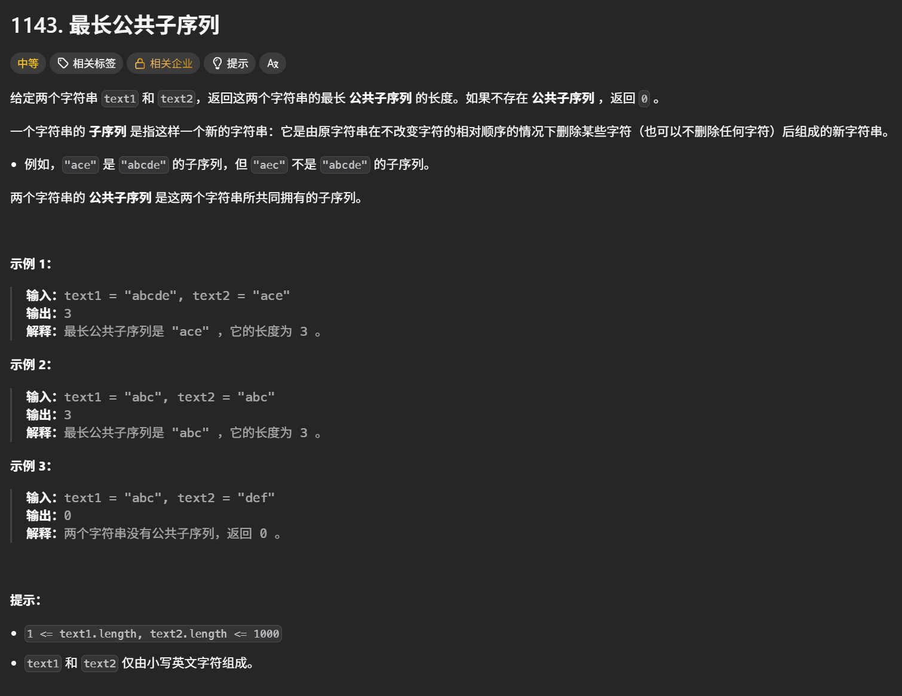

```python
class Solution:
    def longestCommonSubsequence(self, text1: str, text2: str) -> int:
        dp = [[0] * (len(text2) + 1) for _ in range(len(text1) + 1)]
        #相等与不相等，不相等就各自往前推一个比较
        for i in range(1 , len(text1) + 1):
            for j in range(1 , len(text2) + 1):
                if text1[i - 1] == text2[j - 1]:
                    dp[i][j] = dp[i - 1][j - 1] + 1
                else:
                    dp[i][j] = max(dp[i - 1][j] , dp[i][j - 1])
        return dp[len(text1)][len(text2)]
```

#### 不相交的线

[不相交的线](https://leetcode.cn/problems/uncrossed-lines/description/)

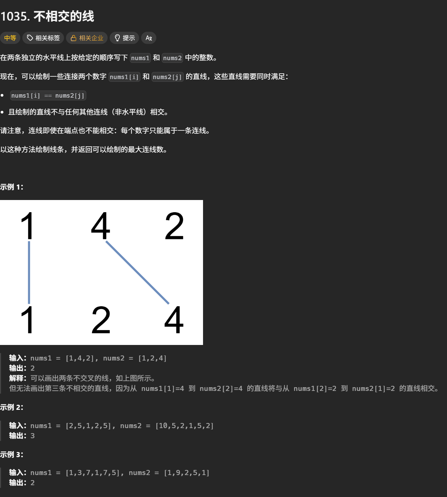

```python
class Solution:
    def maxUncrossedLines(self, nums1: list[int], nums2: list[int]) -> int:
        #本题说是求绘制的最大连线数，其实就是求两个字符串的最长公共子序列的长度！
        dp = [[0] * (len(nums2) + 1) for _ in range(len(nums1) + 1)]
        for i in range(1 , len(nums1) + 1):
            for j in range(1 , len(nums2) + 1):
                if nums1[i - 1] == nums2[j - 1]:
                    dp[i][j] = dp[i - 1][j - 1] + 1
                else:
                    dp[i][j] = max(dp[i - 1][j] , dp[i][j - 1])
        return dp[len(nums1)][len(nums2)]
```
