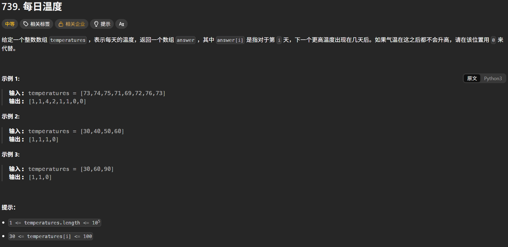
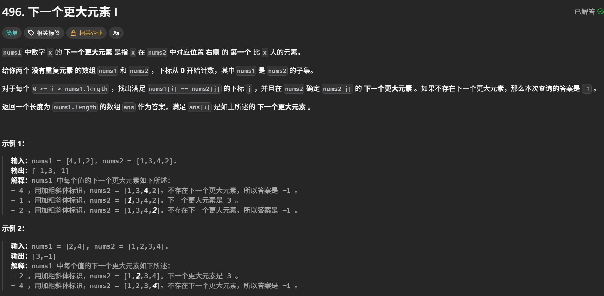
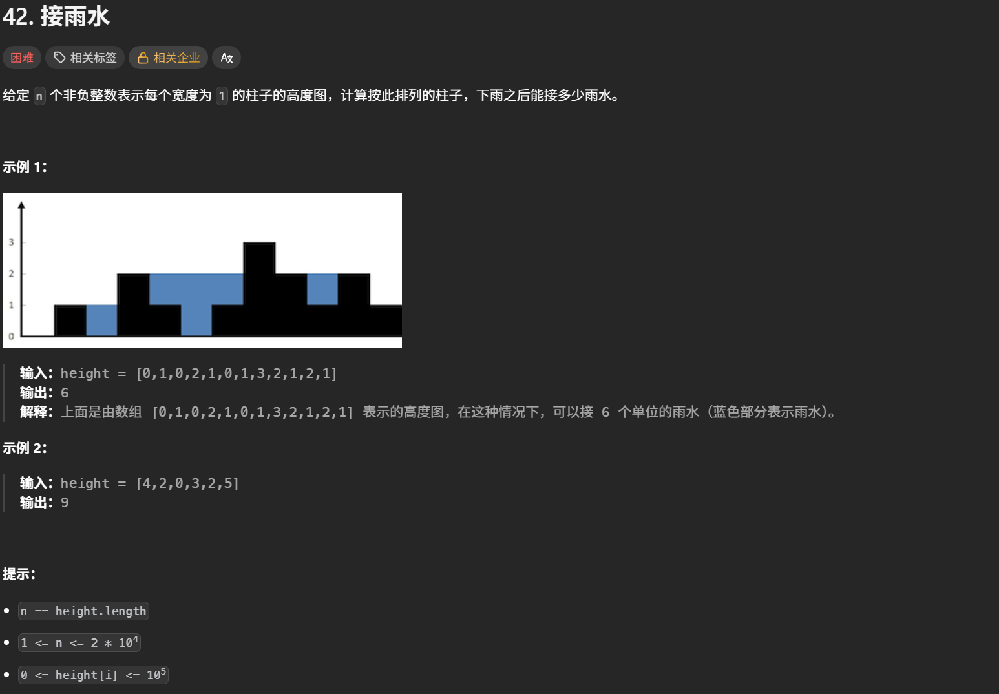

# 单调栈学习心得

本目录用于保存单调栈专题的实现代码，记录栈的维护规则、易错点、边界条件和个人复盘。

## 学习内容

- [ ] 单调栈基础与进出栈规则
- [ ] 下一个更大元素（每日温度、下一个更大元素Ⅰ与Ⅱ）
- [ ] 栈顶两侧的边界（接雨水、柱状图中最大的矩形）
- [ ] 单调栈综合复盘

## 核心思路

- 先确定要找左侧还是右侧、严格更大还是严格更小，再据此决定遍历方向和弹栈条件。
- 以从左向右寻找右侧第一个严格更大的元素为例，栈保存尚未找到答案的下标，对应值从栈底到栈顶非递增。当前值大于栈顶对应值时，弹出栈顶并记录答案，直到条件不再成立，再压入当前下标。
- 常规单次扫描中，每个下标最多入栈、出栈各一次，时间复杂度为 `O(n)`，栈的额外空间为 `O(n)`。

## 易错点与边界条件

- **相等值**。严格更大与大于等于的弹栈规则不同。柱状图遇到等高柱时，要明确保留哪个下标并统一计算边界。
- **值和下标**。需要算等待天数或区间宽度时，栈里保留下标，通过原数组读取对应值。
- **循环数组**。可扫描两轮并用取模访问原下标，第一轮压入待求解下标，第二轮继续处理未解项。
- **未找到边界**。按题意初始化默认结果，比如每日温度填 `0`、下一个更大元素填 `-1`。注意全相等、单调序列和单元素输入。

## 复盘

> 根据每道题的注释和笔记，记录栈内下标的含义、弹栈时确定的边界，以及重复值和收尾处理。

## 代码记录

#### 每日温度

[每日温度](https://leetcode.cn/problems/daily-temperatures/description/)



```python
class Solution:
    def dailyTemperatures(self, temperatures: list[int]) -> list[int]:
        result = [0] * (len(temperatures))
        stack = [0]
        for i in range(1 , len(temperatures)):
            if temperatures[i] <= temperatures[stack[-1]]:
                stack.append(i)
            else:
                while len(stack) != 0 and temperatures[i] > temperatures[stack[-1]]:
                    result[stack[-1]] = i - stack[-1]
                    stack.pop()
                stack.append(i)
        return result

        ##如果当前遍历的元素 大于栈顶元素，表示 栈顶元素的 右边的最大的元素就是 当前遍历的元素，
        ##所以弹出 栈顶元素，并记录
        ##如果栈不空的话，还要考虑新的栈顶与当前元素的大小关系
        ##否则的话，可以直接入栈。
        ##注意，单调栈里 加入的元素是 下标。
```

#### 下一个更大的元素Ⅰ

[下一个更大的元素Ⅰ](https://leetcode.cn/problems/next-greater-element-i/description/)



```python
class Solution:
    def nextGreaterElement(self, nums1: list[int], nums2: list[int]) -> list[int]:
        result = [-1] * (len(nums1))
        stack = [0]
        for i in range(1 , len(nums2)):
            if nums2[i] <= nums2[stack[-1]]:
                stack.append(i)
            else:
                while len(stack) != 0 and nums2[i] > nums2[stack[-1]]:
                    if nums2[stack[-1]] in nums1:
                        index = nums1.index(nums2[stack[-1]])#nums1.index 是方法，要用圆括号调用
                        result[index] = nums2[i]#栈里始终存 nums2 的下标，所以要压入 i。
                    stack.pop()
                stack.append(i)
        return result
```

#### 下一个更大元素Ⅱ

[下一个更大元素Ⅱ](https://leetcode.cn/problems/next-greater-element-ii/description/)


```python
class Solution:
    def nextGreaterElements(self, nums: list[int]) -> list[int]:
        result = [-1] * len(nums)
        stack = [0]
        # 模拟遍历两边nums，注意一下都是用i % nums.size()来操作
        for i in range(1 , len(nums) * 2):
            while (len(stack) != 0) and nums[i % len(nums)] > nums[stack[-1]]:
                result[stack[-1]] = nums[i % len(nums)]
                stack.pop()
            stack.append(i % len(nums))
        return result
```

#### 接雨水

[接雨水](https://leetcode.cn/problems/trapping-rain-water/description/)



```python
class Solution:
    def trap(self, height: list[int]) -> int:
        '''
        单调栈是按照 行 的方向来计算雨水
        从栈顶到栈底的顺序：从小到大
        通过三个元素来接水：栈顶，栈顶的下一个元素，以及即将入栈的元素
        雨水高度是 min(凹槽左边高度, 凹槽右边高度) - 凹槽底部高度
        雨水的宽度是 凹槽右边的下标 - 凹槽左边的下标 - 1（因为只求中间宽度）
        '''
        result = 0#表示能接多少水
        stack = [0] #存下标
        for i in range(1 , len(height)):
            #1.即将入栈的元素高度小于栈顶元素的高度，直接入栈
            if height[i] < height[stack[-1]]:
                stack.append(i)
            #2.即将入栈的元素高度等于栈顶元素的高度，弹出栈顶元素，加入即将入栈的元素
            if height[i] == height[stack[-1]]:
                stack.pop()
                stack.append(i)
            #3.即将入栈的元素高度大于栈顶元素的高度
            if height[i] > height[stack[-1]]:
                while len(stack) != 0 and height[i] > height[stack[-1]]:
                    mid_height = height[stack[-1]]
                    stack.pop()
                    if stack:
                        left_height = height[stack[-1]]
                        right_height = height[i]
                        h = min(left_height , right_height) - mid_height
                        w = i - stack[-1] - 1
                        result += h * w
                stack.append(i)
        return result
```
