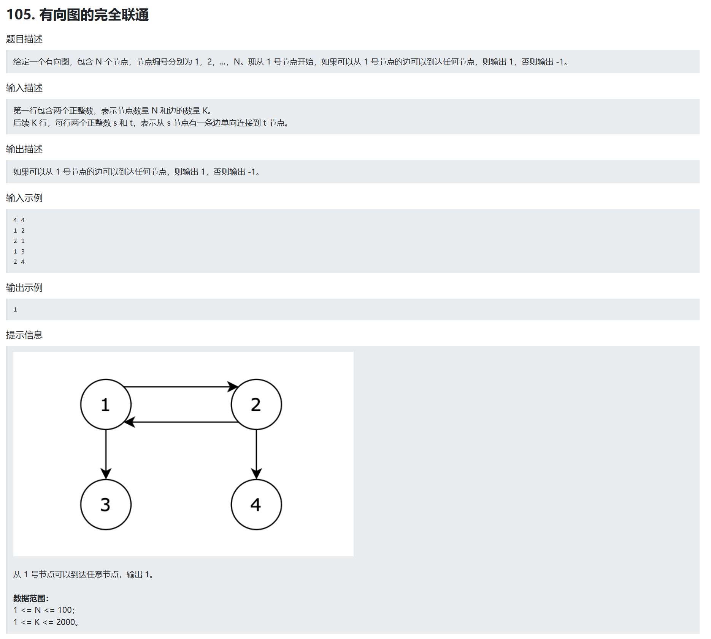
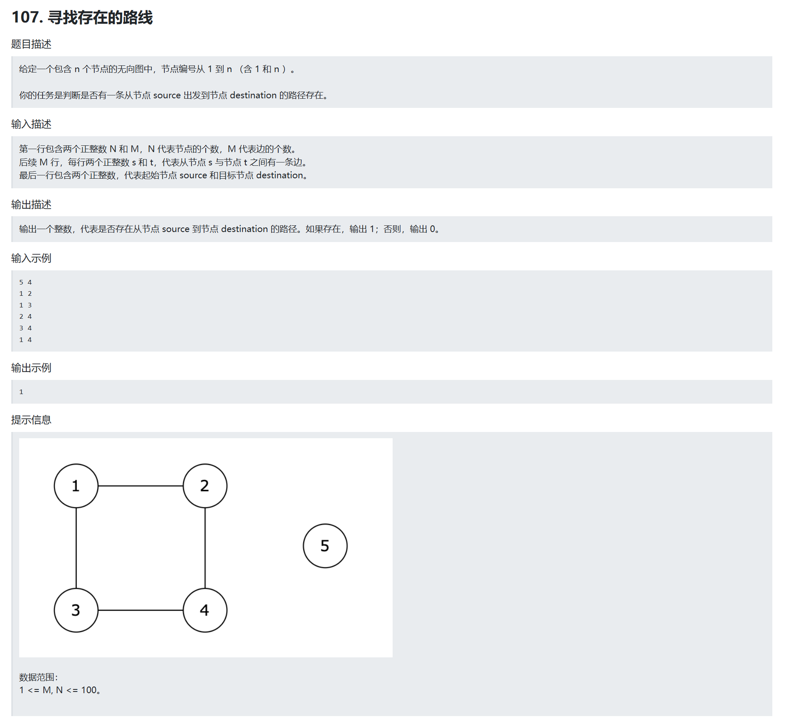

# 图论学习心得

本目录用于记录图论题目的实现代码、建图方法、算法选择、易错点和个人复盘。

## 学习内容

- [x] 图的基本概念与存储（邻接表、邻接矩阵）
- [x] 深度优先搜索与广度优先搜索
- [ ] 连通性与并查集
- [ ] 有向无环图与拓扑排序
- [ ] 最短路径
- [ ] 最小生成树
- [ ] 图论综合复盘

## 核心思路

- 建图前明确顶点编号、边的方向和权重。邻接表适合遍历邻居，也适合边数较少的图。邻接矩阵便于直接查询两点是否相邻，空间为 `O(V²)`。
- 用 DFS 或 BFS 解决可达性问题。使用邻接表时，完整遍历的时间为 `O(V + E)`。无权图求最少边数时，用 BFS 按距离逐层扩展。
- 根据条件选择算法。并查集适合维护无向图的连通性，拓扑排序用于处理有向依赖，Dijkstra 适用于边权非负的最短路径问题。

## 易错点与边界条件

- **建图与编号**。无向边要双向加入邻接表，统一处理从 `0` 或 `1` 开始的编号，并保留孤立点。
- **访问标记**。常规 BFS 在入队时标记已访问，避免同一顶点被重复加入队列。枚举所有简单路径时，可用单独的标记记录当前路径上的顶点，并在回溯时撤销。
- **搜索范围**。从单个起点只能遍历它能到达的顶点。统计无向图的连通分量时，需要从每个尚未访问的顶点重新搜索。
- **有向环**。用入度法做拓扑排序时，如果处理的顶点数少于总数，说明图中存在有向环。
- **不可达与零权边**。用邻接矩阵表示带权图时，明确区分无边和权重为 `0` 的边。返回最短距离前，按题意处理不可达的情况。

## 复盘

> 根据每道题的注释和笔记，记录建图方式、搜索或更新规则、算法适用条件、易错边界和复杂度。

## 代码记录

#### 可达路径

[可达路径](https://kamacoder.com/problempage.php?pid=1170)


###### 邻接矩阵

```python
def main():
    n , m = map(int , input().split())
    graph = [[0] * (n + 1) for _ in range(n + 1)]#邻接矩阵写法，下标从1开始，初始化为(n+1)*(n+1)的数组
    #读取图的指向
    for _ in range(m):
        s , t = map(int , input().split())
        graph[s][t] = 1#只添加了 s → t，表示有向边。
    result = []#存储可能的路径
    dfs(graph , 1 , n , [1] , result)
    if not result:
        print(-1)
    else:
        for path in result:
            print(' '.join(map(str , path)))


def dfs(graph , x , n , path , result):
    if x == n:
        result.append(path.copy())
        return
    for i in range(1 , n + 1):
        if graph[x][i] == 1:
            path.append(i)
            dfs(graph , i , n , path , result)
            path.pop()
if __name__ == "__main__":
    main()
```

###### 邻接表

```python
from collections import defaultdict
def main():
    n , m = map(int , input().split())
    graph = defaultdict(list)#邻接表写法
    #读取图的指向
    for _ in range(m):
        s , t = map(int , input().split())
        graph[s].append(t)#只添加了 s → t，表示有向边。
    result = []#存储可能的路径
    dfs(graph , 1 , n , [1] , result)
    if not result:
        print(-1)
    else:
        for path in result:
            print(' '.join(map(str , path)))


def dfs(graph , x , n , path , result):
    if x == n:
        result.append(path.copy())
        return
    for i in graph[x]:
        path.append(i)
        dfs(graph , i , n , path , result)
        path.pop()
if __name__ == "__main__":
    main()
```

#### 计数孤岛

[计数孤岛](https://kamacoder.com/problempage.php?pid=1171)


###### 深搜版

```python
direction = [[0, 1], [1, 0], [0, -1], [-1, 0]]  # 四个方向：上、右、下、左 x 是行号，向下增大；`y` 是列号，向右增大。

def main():
    #获取矩阵行数列数
    n , m = map(int , input().split())
    #邻接矩阵
    graph = []
    for i in range(n):
        graph.append(list(map(int , input().split())))
    #访问表 用来记住：哪块陆地已经检查过了。 防止 DFS 在相邻格子之间反复走，也防止外层循环把同一个岛数两次。
    visit = [[False] * m for _ in range(n)]
    res = 0
    for i in range(n):
        for j in range(m):
        # 判断：如果当前节点是陆地，res+1并标记访问该节点，使用深度搜索标记相邻陆地。
            if graph[i][j] == 1 and not visit[i][j]:
                res += 1
                visit[i][j] = True
                dfs(graph , visit , i , j)
    print(res)

def dfs(graph , visit , x , y):
    """
    对一块陆地进行深度优先遍历并标记
    """
    for i , j in direction:
        next_x = x + i
        next_y = y + j
        # 下标越界，跳过
        if next_x < 0 or next_x >= len(graph) or next_y < 0 or next_y >= len(graph[0]):
            continue
        # 未访问的陆地，标记并调用深度优先搜索
        if not visit[next_x][next_y] and graph[next_x][next_y] == 1:
            visit[next_x][next_y] = True
            dfs(graph , visit , next_x , next_y)

if __name__ == "__main__":
    main()
```

###### 广度搜索

```python
from collections import deque
direction = [[0, 1], [1, 0], [0, -1], [-1, 0]]  # 四个方向：上、右、下、左 x 是行号，向下增大；`y` 是列号，向右增大。

def main():
    #获取矩阵行数列数
    n , m = map(int , input().split())
    #邻接矩阵
    graph = []
    for i in range(n):
        graph.append(list(map(int , input().split())))
    #访问表 用来记住：哪块陆地已经检查过了。 防止 DFS 在相邻格子之间反复走，也防止外层循环把同一个岛数两次。
    visit = [[False] * m for _ in range(n)]
    res = 0
    for i in range(n):
        for j in range(m):
        # 判断：如果当前节点是陆地，res+1并标记访问该节点，使用深度搜索标记相邻陆地。
            if graph[i][j] == 1 and not visit[i][j]:
                res += 1
                visit[i][j] = True
                dfs(graph , visit , i , j)
    print(res)

def dfs(graph , visit , x , y):
    """
    对一块陆地进行广度优先遍历并标记
    """
    que = deque([])
    que.append([x,y])
    visit[x][y] = True
    while que:
        cur_x , cur_y = que.popleft()
        for i , j in direction:
            next_x = i + cur_x
            next_y = j + cur_y
            # 下标越界，跳过
            if next_x < 0 or next_x >= len(graph) or next_y < 0 or next_y >= len(graph[0]):
                continue
            # 未访问的陆地，标记并调用深度优先搜索
            if not visit[next_x][next_y] and graph[next_x][next_y] == 1:
                visit[next_x][next_y] = True
                que.append([next_x , next_y])

if __name__ == "__main__":
    main()
```

#### 最大岛屿面积

[最大岛屿面积](https://kamacoder.com/problempage.php?pid=1172)


```python
direcrtions = [ [0 , 1] , [0 , -1] , [1 , 0] , [-1 , 0] ]
count = 0#记录每片岛屿的面积
def main():
    global count#声明为全局变量，不要赋值
    n , m = map(int , input().split())
    #邻接矩阵
    graph = []
    for i in range(n):
        graph.append(list(map(int , input().split())))
    #访问表
    visit = [[False] * m for _ in range(n)]
    result = 0 #最大面积
    for i in range(n):
        for j in range(m):
            if graph[i][j] == 1 and not visit[i][j]:#当前位置是岛屿且为访问过
                count = 1
                visit[i][j] = True
                dfs(graph , i , j , visit)
                result = max(result , count)
    print(result)

def dfs(graph , x , y , visit):
    global count#声明为全局变量
    for i , j in direcrtions:
        next_x = i + x
        next_y = j + y
        #下标越界，直接跳过
        if next_x < 0 or next_x >= len(graph) or next_y < 0 or next_y >= len(graph[0]):
            continue
        if graph[next_x][next_y] == 1 and not visit[next_x][next_y]:
            visit[next_x][next_y] = True
            count += 1
            dfs(graph , next_x , next_y , visit)
if __name__ == "__main__":
    main()

```

#### 孤岛的总面积

[孤岛的总面积](https://kamacoder.com/problempage.php?pid=1173)


```python
directions = [[0 , 1] , [0 , -1] , [1 , 0] , [-1 , 0]]
count = 0
def main():
    global count
    n , m = map(int , input().split())
    graph = []
    for i in range(n):
        graph.append(list(map(int , input().split())))
    #清楚边界上的联通分量
    for i in range(n):
        if graph[i][0] == 1:
            dfs(graph , i , 0)
        if graph[i][m - 1] == 1:
            dfs(graph , i , m - 1)
    for j in range(m):
        if graph[0][j] == 1:
            dfs(graph , 0 , j)
        if graph[n - 1][j] == 1:
            dfs(graph , n - 1 , j)
    #重新遍历地图，统计孤岛面积
    count = 0
    for i in range(n):
        for j in range(m):
            if graph[i][j] == 1:
                dfs(graph , i , j)
    print(count)

def dfs(graph , x , y):
    global count
    graph[x][y] = 0
    count += 1
    for i , j in directions:
        next_x = x + i
        next_y = y + j
        #越界判断
        if next_x < 0 or next_x>= len(graph) or next_y < 0 or next_y >= len(graph[0]):
            continue
        if graph[next_x][next_y] == 1:
            dfs(graph , next_x , next_y)
if __name__== "__main__":
    main()
```

#### 沉没的孤岛

[沉没的孤岛](https://kamacoder.com/problempage.php?pid=1174)


```python
directions = [[0 , 1] , [0 , -1] , [1 , 0] , [-1 , 0]]
def main():
    n , m =map(int , input().split())
    graph = []
    for i in range(n):
        graph.append(list(map(int , input().split())))
    for i in range(n):
        if graph[i][0] == 1:
            dfs(graph , i , 0)
        if graph[i][m - 1] == 1:
            dfs(graph , i , m - 1)
    for j in range(m):
        if graph[0][j] == 1:
            dfs(graph , 0 , j)
        if graph[n - 1][j] == 1:
            dfs(graph , n - 1 , j)
    #将2改为1，1改为0
    for i in range(n):
        for j in range(m):
            if graph[i][j] == 1:
                graph[i][j] = 0
            elif graph[i][j] == 2:
                graph[i][j] = 1
    for i in graph:
        print(' '.join(map(str , i)))

def dfs(graph , x , y):
    graph[x][y] = 2
    for i , j in directions:
        next_x = i + x
        next_y = j + y
        #判断是否越界
        if next_x < 0 or next_x >= len(graph) or next_y < 0 or next_y >= len(graph[0]):
            continue
        #判断是否为孤岛，不是孤岛，就跳过
        if graph[next_x][next_y] == 0 or graph[next_x][next_y] == 2:
            continue
        dfs(graph , next_x , next_y)
if __name__ == "__main__":
    main()
```

#### 高山流水

[高山流水](https://kamacoder.com/problempage.php?pid=1175)


```python
directions = [[0 , 1] , [0 , -1] , [1 , 0] , [-1 , 0]]
first = set()#第一个边界
second = set()#第二个边界

def main():
    global first , second
    n , m = map(int , input().split())
    graph = []
    for i in range(n):
        graph.append(list(map(int , input().split())))
    #判断是否能到达第一边界
    visit = [[False] * m for _ in range(n)]
    for i in range(m):
        dfs(graph , visit , 0 , i , first)
    for i in range(n):
        dfs(graph , visit , i , 0 , first)
    #判断是否能到达第二边界
    visit = [[False] * m for _ in range(n)]
    for i in range(m):
        dfs(graph , visit , n - 1 , i , second)
    for i in range(n):
        dfs(graph , visit , i , m - 1 , second)
    #取都能到达第一边界和第二边界的点
    res = first & second
    for i in res:
        print(" ".join(map(str , i)))

def dfs(graph , visit , x , y , side):
    global first , second
    if visit[x][y]:#访问过的点不再访问
        return
    visit[x][y] = True
    side.add((x , y))#set集合添加元素用add
    for i , j in directions:
        next_x = i + x
        next_y = j + y
        #边界判断
        if next_x < 0 or next_x >= len(graph) or next_y < 0 or next_y >= len(graph[0]):
            continue
        if graph[next_x][next_y] >= graph[x][y]:
            dfs(graph , visit , next_x , next_y , side)

if __name__ == "__main__":
    main()
```

#### 建造最大岛屿

[建造最大岛屿](https://kamacoder.com/problempage.php?pid=1176)


```python
import collections
#先用 DFS 给每个岛编号、记下它的面积；再枚举每个水格，看看把它变成陆地后，最多能连成多大的岛。
directions = [[0 , 1] , [0 , -1] , [1 , 0] , [-1 , 0]]
area = 0
def main():
    global area
    n , m = map(int , input().split())
    graph = []
    for i in range(n):
        graph.append(list(map(int , input().split())))
    visited = [[False] * m for _ in range(n)]#记录访问的点
    rec = collections.defaultdict(int)#初始化键值，岛屿编号-》对应面积
    cnt = 2 #从编号2开始
    for i in range(n):
        for j in range(m):
            if graph[i][j] == 1:
                area = 0
                dfs(graph , visited , i , j , cnt)
                rec[cnt] = area#记录对应编号岛屿的面积
                cnt += 1
    #求将水变为陆地之后的最大面积
    res = 0
    for i in range(n):
        for j in range(m):
            if graph[i][j] == 0:
                v = set()
                max_island = 1
                for  x ,y in directions:
                    next_x = i + x
                    next_y = j + y
                    if (0 <= next_x and next_x < n and next_y >=0 and next_y < m and graph[next_x][next_y] != 0 and graph[next_x][next_y] not in v):
                        max_island += rec[graph[next_x][next_y]]
                        v.add(graph[next_x][next_y])
                res = max(res , max_island)
    if res == 0:
        return max(rec.values())   #无水情况
    return res

def dfs(graph , visited , x , y , cnt):
    global area
    if visited[x][y]:#访问过的点不再访问
        return
    visited[x][y] = True
    graph[x][y] = cnt
    area += 1
    for i , j in directions:
        next_x = i + x
        next_y = j + y
        #边界判断
        if next_x < 0 or next_x >= len(graph) or next_y < 0 or next_y >= len(graph[0]):
            continue
        if graph[next_x][next_y] == 1:
            dfs(graph , visited , next_x , next_y , cnt)
if __name__ == "__main__":
    print(main())

```

#### 海岸线计算

[海岸线计算](https://kamacoder.com/problempage.php?pid=1178)


```python
n , m = map(int , input().split())
graph = []
for i in range(n):
    graph.append(list(map(int , input().split())))
sum_land = 0 #陆地数量
cover = 0 #相邻陆地数量
for i in range(n):
    for j in range(m):
        if graph[i][j] == 1:
            sum_land += 1
            #上方也有陆地
            if i - 1 >= 0 and graph[i - 1][j] == 1:#允许等于0
                cover += 1
            #左方也有陆地
            if j - 1 >= 0 and graph[i][j - 1] == 1:#允许等于0
                cover += 1
result = sum_land * 4 - 2 * cover
print(result)
```

#### 字符串迁移

[字符串迁移](https://kamacoder.com/problempage.php?pid=1183)


```python
from collections import deque
#判断两个字符串是否只差一个字符
def judge(s1 , s2):
    count = 0
    for i in range(len(s1)):
        if s1[i] != s2[i]:
            count += 1
    return count == 1

def main():
    n = int(input())
    beginStr , endStr = map(str , input().split())
    if beginStr == endStr:
        print(0)
        exit()
    strlist = []
    for i in range(n):
        strlist.append(input())
    #记录访问过的字符串
    visit = [False] * n
    myque = deque([[beginStr , 1]])  # 创建队列，数据量较大时，这样取队首不用移动后面的元素
    while myque:
        zifu , step = myque.popleft()#取队首
        if judge(zifu , endStr):#当前字符串是否之和最后一个字符串相差一个字符
            print(step + 1)
            exit()
        for i in range(n):
            if not visit[i] and judge(strlist[i] , zifu):
                visit[i] = True
                myque.append([strlist[i] , step + 1])
    print(0)
if __name__ == "__main__":
    main()
```

#### 有向图的完全联通

[有向图的完全联通](https://kamacoder.com/problempage.php?pid=1177)



```python
def main():
    n , m = map(int , input().split())
    graph = [[] for _ in range(n + 1)]## graph[s] 存放从节点 s 出发能直接到达的节点
    for i in range(m):
        s , t = map(int , input().split())
        graph[s].append(t)
    visit = [False]* (n + 1)#从下标1开始
    visit[1] = True
    dfs(graph , visit , 1)#地图、访问记录、搜索开始下标
    #如果还有False，就说明无法达到全部节点
    for i in range(1 , n + 1):
        if not visit[i]:
            print(-1)
            exit()
    print(1)

def dfs(graph , visit , index):
    for i in graph[index]:#index 是当前节点；`i` 是从邻接表中取出的下一个节点
        if not visit[i]:
            visit[i] = True
            dfs(graph , visit , i)
if __name__ == "__main__":
    main()
```

#### 寻找存在的路线

[寻找存在的路线](https://kamacoder.com/problempage.php?pid=1179)



```python
class UnionFind:#并查集
    def __init__(self , size):
        self.father = list(range(size + 1))#初始化并查集
    def find(self , u):
        if self.father[u] != u:#不是根节点
            self.father[u] = self.find(self.father[u])#路径压缩.让所有节点都指向根节点
        return self.father[u]
    def join(self , u , v):#将v->u 这条边加入并查集
        root_u = self.find(u)
        root_v = self.find(v)
        if root_u != root_v:
            self.father[root_v] = root_u
    def is_same(self , u , v):
        return self.find(u) == self.find(v)
def main():
    n , m = map(int , input().split())
    uf = UnionFind(n)#初始化对象
    for _ in range(m):
        s , t = map(int , input().split())
        uf.join(s , t)
    source , destination = map(int , input().split())
    if uf.is_same(source , destination):
        print(1)
    else:
        print(0)
if __name__ == "__main__":
    main()
```

#### 多余的边

[多余的边](https://kamacoder.com/problempage.php?pid=1181)


```python
class UnionFind:#并查集
    def __init__(self , size):
        self.father = list(range(size + 1))#初始化并查集
    def find(self , u):
        if self.father[u] != u:#不是根节点
            self.father[u] = self.find(self.father[u])#路径压缩.让所有节点都指向根节点
        return self.father[u]
    def join(self , u , v):#将v->u 这条边加入并查集
        root_u = self.find(u)
        root_v = self.find(v)
        if root_u != root_v:
            self.father[root_v] = root_u
    def is_same(self , u , v):
        return self.find(u) == self.find(v)
def main():
    n = int(input())
    uf = UnionFind(n)
    for _ in range(n):
        s , t = map(int , input().split())
        if uf.is_same(s , t):#s , t在同一集合里
            result = str(s) + ' ' + str(t)
        else:#不在同一集合里，就加进来
            uf.join(s , t)
    print(result)
if __name__ == "__main__":
    main()
```

#### 多余的边Ⅱ

[多余的边Ⅱ](https://kamacoder.com/problempage.php?pid=1182)


```python
class UnionFind:
    def __init__(self, size):
        self.father = list(range(size + 1))

    def find(self, u):
        if self.father[u] != u:
            self.father[u] = self.find(self.father[u])
        return self.father[u]

    def join(self, u, v):
        root_u = self.find(u)
        root_v = self.find(v)
        if root_u != root_v:
            self.father[root_v] = root_u

    def is_same(self, u, v):
        return self.find(u) == self.find(v)


def is_tree_after_remove_edge(edges, remove_index, n):
    uf = UnionFind(n)  # 每次试删都重新开始建图

    for i in range(len(edges)):
        if i == remove_index:
            continue

        s, t = edges[i]
        if uf.is_same(s, t):
            return False  # 加入这条边会形成环
        uf.join(s, t)

    return True


def main():
    n = int(input())
    edges = []
    in_degree = [0] * (n + 1)

    for _ in range(n):
        s, t = map(int, input().split())
        edges.append((s, t))
        in_degree[t] += 1  # s → t，增加的是 t 的入度

    # 倒序找指向同一个入度为 2 的节点的两条边
    candidates = []
    for i in range(n - 1, -1, -1):
        s, t = edges[i]
        if in_degree[t] == 2:
            candidates.append(i)

    if candidates:
        later, earlier = candidates

        # 优先试删输入顺序靠后的那条边
        if is_tree_after_remove_edge(edges, later, n):
            s, t = edges[later]
        else:
            s, t = edges[earlier]

        print(s, t)
        return

    # 没有节点入度为 2，就用并查集找成环的边
    uf = UnionFind(n)
    for s, t in edges:
        if uf.is_same(s, t):
            print(s, t)
            return
        uf.join(s, t)


if __name__ == "__main__":
    main()
```

#### 最小生成树之prim

[最小生成树之prim](https://kamacoder.com/problempage.php?pid=1053)


```python
# 接收输入
v, e = list(map(int, input().split()))
# 按照常规的邻接矩阵存储图信息，不可达的初始化为10001
graph = [[10001] * (v+1) for _ in range(v+1)]#下标从1开始，为了和节点编号对齐
for _ in range(e):#无向有权值图
    x, y, w = list(map(int, input().split()))
    graph[x][y] = w
    graph[y][x] = w

# 定义加入生成树的标记数组和未加入生成树的最近距离
visited = [False] * (v + 1)
minDist = [10001] * (v + 1)#因为val小于10000，所以初始化数组为10001

# 循环 n - 1 次，建立 n - 1 条边
# 从节点视角来看：每次选中一个节点加入树，更新剩余的节点到树的最短距离，
# 这一步其实蕴含了确定下一条选取的边，计入总路程 ans 的计算
#外层循环每轮选一个节点；第一个内层循环决定选谁；第二个内层循环用新节点更新剩余节点的连接成本
for _ in range(1, v + 1):
    min_val = 10002
    cur = -1
    for j in range(1, v + 1):
        if visited[j] == False and minDist[j] < min_val:#扫描所有未加入的节点，找 minDist[j] 最小的那个，记为 cur
            cur = j
            min_val = minDist[j]
    visited[cur] = True
    for j in range(1, v + 1):#	检查新加入的 cur 到每个未加入节点 j 的边。如果 graph[cur][j] 更便宜，就更新 minDist[j]
        if visited[j] == False and minDist[j] > graph[cur][j]:#
            minDist[j] = graph[cur][j]

ans = 0
for i in range(2, v + 1):#把选中的边权加起来
    ans += minDist[i]
print(ans)
```

#### 最小生成树之kruskal

```python
class Edge:
    """存储一条无向边：两个端点和边的权重。"""

    def __init__(self, l, r, val):
        self.l = l      # 边的一个端点
        self.r = r      # 边的另一个端点
        self.val = val  # 边的权重


# 并查集预留 10001 个位置，可访问的下标是 0 到 10000
n = 10001
father = list(range(n))


def init():
    global father
    # 每个节点的父节点初始化为自己，各自形成一个集合
    father = list(range(n))


def find(u):
    # 如果父节点不是自己，就继续向上找根节点
    if u != father[u]:
        # 路径压缩：找到根后，让 u 直接指向根，下次查找更快
        father[u] = find(father[u])
    return father[u]


def join(u, v):
    # 先找到两个节点所在集合的根
    u = find(u)
    v = find(v)

    # 两个集合不同，就把 v 的根挂到 u 的根下面
    if u != v:
        father[v] = u


def kruskal(v, edges):
    # 按边权 val 从小到大排序
    edges.sort(key=lambda edge: edge.val)
    init()
    result_val = 0  # 已选边的权重之和

    for edge in edges:
        # 查找这条边两个端点所在集合的根
        x = find(edge.l)
        y = find(edge.r)

        # 根不同：两个端点还不连通，可以选这条边
        # 根相同：两个端点已经连通，再加这条边会成环，跳过
        if x != y:
            result_val += edge.val
            join(x, y)  # 选了这条边，两个集合现在连通了

    return result_val


def main():
    v, e = map(int, input().split())  # v 是节点数，e 是边数
    edges = []

    for _ in range(e):
        v1, v2, val = map(int, input().split())  # 两个端点和边权
        edges.append(Edge(v1, v2, val))

    result_val = kruskal(v, edges)
    print(result_val)


if __name__ == "__main__":
    main()
```

#### 拓扑排序

[拓扑排序](https://kamacoder.com/problempage.php?pid=1191)


```python
from collections import deque, defaultdict

def topological_sort(n, edges):
    # 文件编号是 0 到 n - 1
    # in_degree[i] 表示文件 i 的入度
    in_degree = [0] * n
    graph = defaultdict(list)  # 邻接表：graph[s] 存放依赖文件 s 的文件

    for s, t in edges:
        # s -> t：必须先处理 s，再处理 t
        graph[s].append(t)
        in_degree[t] += 1

    queue = deque()
    for i in range(n):
        if in_degree[i] == 0:#入度为0，直接加进队列
            queue.append(i)

    result = []
    while queue:
        cur = queue.popleft()  # 从队首取出一个可以处理的文件
        result.append(cur)

        for next_file in graph[cur]:
            # cur 已经处理完，next_file 就少了一个入度
            in_degree[next_file] -= 1
            if in_degree[next_file] == 0:
                queue.append(next_file)  # 入度为0，可以入队

    if len(result) == n:
        print(" ".join(map(str, result)))
    else:
        # 队列已经空了，却还有文件没处理，说明依赖关系中存在环
        print(-1)


def main():
    n, m = map(int, input().split())  # n 个文件，m 条依赖关系

    edges = []
    for _ in range(m):
        s, t = map(int, input().split())
        edges.append((s, t))

    topological_sort(n, edges)


if __name__ == "__main__":
    main()
```

#### dijkstra朴素版

[dijkstra朴素版](https://kamacoder.com/problempage.php?pid=1047)


```python
import sys


def dijkstra(n, edges, start, end):
    inf = float('inf')

    # 初始化邻接矩阵，grid[p1][p2] 表示有向边 p1 -> p2 的权值
    grid = [[inf] * (n + 1) for _ in range(n + 1)]
    for p1, p2, val in edges:
        # 两个节点之间有多条同向边时，保留权值最小的一条
        grid[p1][p2] = min(grid[p1][p2], val)

    # minDist[v] 表示目前找到的从起点到节点 v 的最短距离
    minDist = [inf] * (n + 1)
    # visited[v] 为 True，表示节点 v 的最短距离已经确定
    visited = [False] * (n + 1)
    minDist[start] = 0

    for _ in range(n):
        minVal = inf
        cur = -1

        # 在最短距离尚未确定的节点中，选出当前距离起点最近的节点
        for v in range(1, n + 1):
            if not visited[v] and minDist[v] < minVal:
                minVal = minDist[v]
                cur = v

        # 剩余节点的距离都是无穷大，说明它们从起点不可达
        if cur == -1:
            break

        visited[cur] = True

        # 终点被选中时，最短距离已经确定，可以直接返回
        if cur == end:
            return minDist[cur]

        # 尝试经过 cur 到达其他节点，看看距离能否缩短
        for v in range(1, n + 1):
            if visited[v] or grid[cur][v] == inf:
                continue

            newDist = minDist[cur] + grid[cur][v]
            if newDist < minDist[v]:
                minDist[v] = newDist

    # 搜索结束时仍未选中终点，说明终点不可达
    return -1


if __name__ == "__main__":
    data = sys.stdin.read().split()
    n, m = int(data[0]), int(data[1])

    edges = []
    for index in range(2, 2 + 3 * m, 3):
        p1 = int(data[index])
        p2 = int(data[index + 1])
        val = int(data[index + 2])
        edges.append((p1, p2, val))

    start = 1
    end = n
    print(dijkstra(n, edges, start, end))
```

#### dijkstra堆优化版

```python
import heapq


class Edge:
    def __init__(self, to, val):
        self.to = to
        self.val = val


def dijkstra(n, edges, start, end):
    # 建立邻接表，grid[p1] 保存从 p1 出发的所有有向边
    grid = [[] for _ in range(n + 1)]
    for p1, p2, val in edges:
        grid[p1].append(Edge(p2, val))

    # minDist[v] 表示目前找到的从起点到 v 的最短距离
    minDist = [float('inf')] * (n + 1)
    # visited[v] 为 True，表示 v 的最短距离已经确定
    visited = [False] * (n + 1)

    minDist[start] = 0

    # 小顶堆中存放 (距离, 节点)，距离最小的元素先出堆
    pq = [(0, start)]

    while pq:
        curDist, cur = heapq.heappop(pq)

        # 同一个节点可能多次入堆，最短距离已确定就跳过
        if visited[cur]:
            continue

        visited[cur] = True

        # 边权非负时，终点第一次出堆就可以确定最短距离
        if cur == end:
            return curDist

        # 只遍历从 cur 出发的边，尝试更新相邻节点的距离
        for edge in grid[cur]:
            v = edge.to
            if visited[v]:
                continue

            newDist = curDist + edge.val
            if newDist < minDist[v]:
                minDist[v] = newDist
                heapq.heappush(pq, (newDist, v))

    # 堆为空时仍未到达终点，说明终点不可达
    return -1


if __name__ == "__main__":
    n, m = map(int, input().split())

    edges = []
    for _ in range(m):
        p1, p2, val = map(int, input().split())
        edges.append((p1, p2, val))

    start = 1
    end = n
    result = dijkstra(n, edges, start, end)
    print(result)
```

#### Bellman_ford算法

[Bellman_ford算法](https://kamacoder.com/problempage.php?pid=1152)

（与前一道题不同的是这道题出现负数了）


```python
def bellman_ford(n, edges, start, end):
    #对所有节点松弛n-1次，就能得到起点到终点的最短距离
    inf = float('inf')
    # minDist[v] 表示目前找到的从起点到节点 v 的最短距离
    minDist = [inf] * (n + 1)
    minDist[start] = 0
    # 最多进行 n - 1 轮松弛，每轮遍历所有边
    for _ in range(n - 1):
        updated = False
        for p1, p2, val in edges:
            # 目前还没找到到达 p1 的路径，先跳过这条边
            if minDist[p1] == inf:
                continue
            # 尝试经过 p1 到达 p2，看看距离能否缩短
            newDist = minDist[p1] + val
            if newDist < minDist[p2]:
                minDist[p2] = newDist
                updated = True
        # 整轮遍历都没有更新，可以提前结束
        if not updated:
            break
    if minDist[end] == inf:
        return "unconnected"
    return minDist[end]

if __name__ == "__main__":
    n, m = map(int, input().split())

    edges = []
    for _ in range(m):
        p1, p2, val = map(int, input().split())
        edges.append((p1, p2, val))

    start = 1
    end = n
    result = bellman_ford(n, edges, start, end)
    print(result)
```
##### Bellman_ford之队列优化

```python
from collections import deque


def spfa(n, grid, start, end):
    inf = float('inf')
    minDist = [inf] * (n + 1)
    minDist[start] = 0

    # inQueue[v] 表示节点 v 当前是否在队列中
    inQueue = [False] * (n + 1)
    que = deque([start])
    inQueue[start] = True

    while que:
        cur = que.popleft()
        inQueue[cur] = False
        curDist = minDist[cur]

        # 尝试经过 cur 到达 v，看看距离能否缩短
        for v, val in grid[cur]:
            newDist = curDist + val
            if newDist < minDist[v]:
                minDist[v] = newDist

                # v 已在队列中时，出队后会直接读取最新距离
                if not inQueue[v]:
                    que.append(v)
                    inQueue[v] = True

    if minDist[end] == inf:
        return "unconnected"
    return minDist[end]


if __name__ == "__main__":
    n, m = map(int, input().split())

    # grid[p1] 保存从 p1 出发的所有有向边
    grid = [[] for _ in range(n + 1)]
    for _ in range(m):
        p1, p2, val = map(int, input().split())
        grid[p1].append((p2, val))

    start = 1
    end = n
    result = spfa(n, grid, start, end)
    print(result)
```

#### Bellman_ford之队列优化

[Bellman_ford之队列优化](https://kamacoder.com/problempage.php?pid=1153)


```python
def bellman_ford(n, edges, start, end):
    inf = float('inf')
    minDist = [inf] * (n + 1)
    minDist[start] = 0

    # 前 n - 1 轮更新最短距离，第 n 轮检查负权回路
    for i in range(1, n + 1):
        updated = False
        for p1, p2, val in edges:
            # 目前还无法到达 p1，跳过这条边
            if minDist[p1] == inf:
                continue

            newDist = minDist[p1] + val
            if newDist < minDist[p2]:
                # 第 n 轮还能缩短距离，说明起点能到达负权回路
                if i == n:
                    return "circle"

                minDist[p2] = newDist
                updated = True

        # 整轮没有更新，后续距离也不会变化
        if not updated:
            break

    if minDist[end] == inf:
        return "unconnected"
    return minDist[end]


if __name__ == "__main__":
    n, m = map(int, input().split())

    edges = []
    for _ in range(m):
        p1, p2, val = map(int, input().split())
        edges.append((p1, p2, val))

    start = 1
    end = n
    result = bellman_ford(n, edges, start, end)
    print(result)
```

#### Bellman_ford之单源有限最短路径

[Bellman_ford之单源有限最短路径](https://kamacoder.com/problempage.php?pid=1154)


```python
def bellman_ford(n, edges, start, end, k):
    inf = float('inf')
    minDist = [inf] * (n + 1)
    minDist[start] = 0

    # 最多经过 k 个中间城市，也就是最多走 k + 1 条边
    for _ in range(k + 1):
        updated = False
        minDistCopy = minDist.copy()#用来记录上一次遍历的结果

        for p1, p2, val in edges:
            # 上一轮还无法到达 p1，跳过这条边
            if minDistCopy[p1] == inf:
                continue

            # 用上一轮到 p1 的距离，加上一条边到达 p2
            newDist = minDistCopy[p1] + val
            if newDist < minDist[p2]:
                minDist[p2] = newDist
                updated = True

        # 整轮没有更新，可以提前结束
        if not updated:
            break

    if minDist[end] == inf:
        return "unreachable"
    return minDist[end]


if __name__ == "__main__":
    n, m = map(int, input().split())

    edges = []
    for _ in range(m):
        p1, p2, val = map(int, input().split())
        edges.append((p1, p2, val))

    start, end, k = map(int, input().split())
    result = bellman_ford(n, edges, start, end, k)
    print(result)
```

#### Floyd算法

[Floyd算法](https://kamacoder.com/problempage.php?pid=1155)


```python
def floyd(n, grid):
    # k 表示本轮允许作为中转点的节点
    for k in range(1, n + 1):
        for i in range(1, n + 1):
            for j in range(1, n + 1):
                # 尝试从 i 经过 k 到达 j
                newDist = grid[i][k] + grid[k][j]
                if newDist < grid[i][j]:
                    grid[i][j] = newDist


if __name__ == "__main__":
    n, m = map(int, input().split())
    inf = float('inf')

    # grid[i][j] 表示目前找到的从 i 到 j 的最短距离
    grid = [[inf] * (n + 1) for _ in range(n + 1)]
    for i in range(1, n + 1):
        grid[i][i] = 0

    for _ in range(m):
        p1, p2, val = map(int, input().split())

        # 无向边要更新两个方向，有重边时保留较小的边权
        if val < grid[p1][p2]:
            grid[p1][p2] = val
            grid[p2][p1] = val

    floyd(n, grid)

    z = int(input())
    for _ in range(z):
        start, end = map(int, input().split())
        if grid[start][end] == inf:
            print(-1)
        else:
            print(grid[start][end])
```
