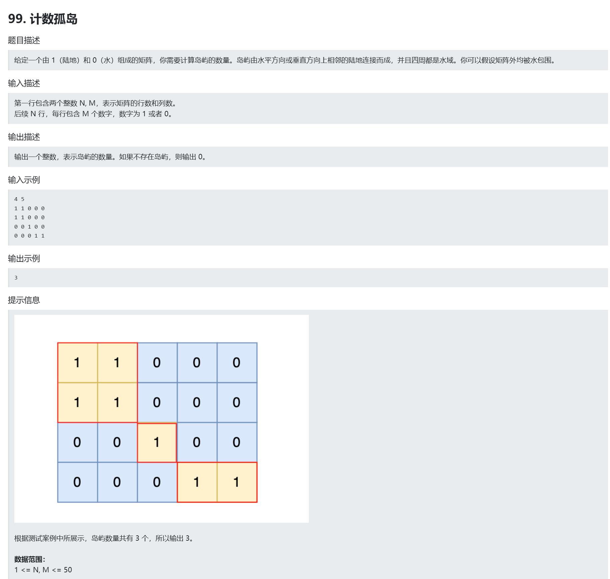
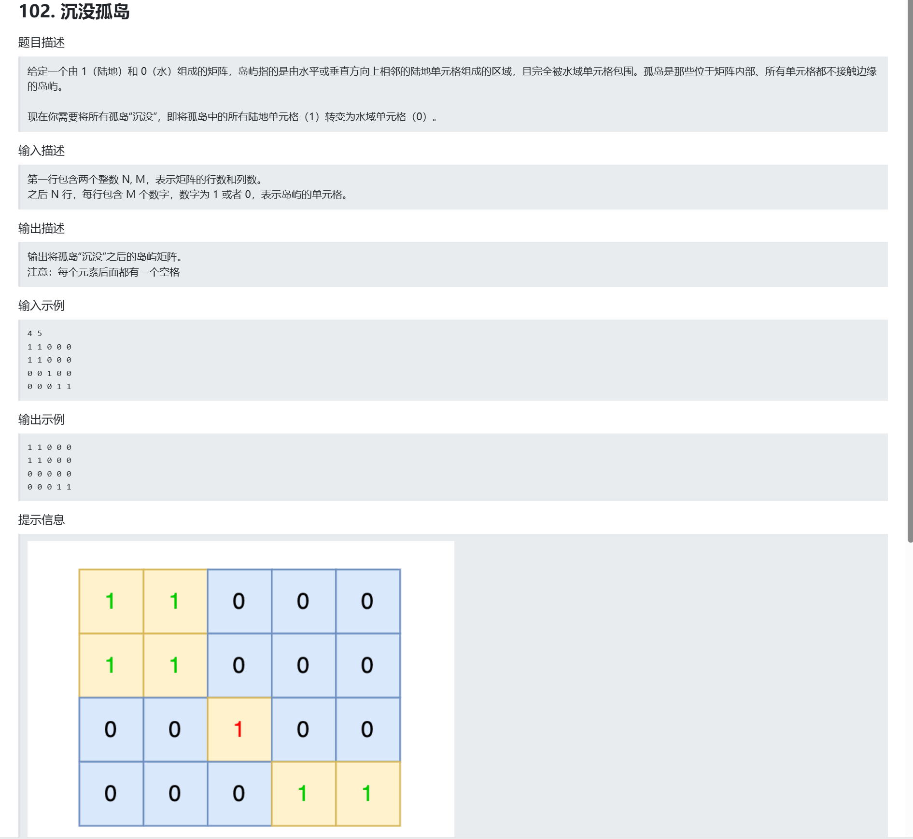

# 图论学习心得

本目录用于记录图论题目的实现代码、建图方法、算法选择、易错点和个人复盘。

## 学习内容

- [x] 图的基本概念与存储（邻接表、邻接矩阵）
- [x] 深度优先搜索与广度优先搜索
- [ ] 连通性与并查集
- [ ] 有向无环图与拓扑排序
- [ ] 最短路径
- [ ] 最小生成树
- [ ] 图论综合复盘

## 核心思路

- 建图前明确顶点编号、边的方向和权重。邻接表适合遍历邻居，也适合边数较少的图。邻接矩阵便于直接查询两点是否相邻，空间为 `O(V²)`。
- 用 DFS 或 BFS 解决可达性问题。使用邻接表时，完整遍历的时间为 `O(V + E)`。无权图求最少边数时，用 BFS 按距离逐层扩展。
- 根据条件选择算法。并查集适合维护无向图的连通性，拓扑排序用于处理有向依赖，Dijkstra 适用于边权非负的最短路径问题。

## 易错点与边界条件

- **建图与编号**。无向边要双向加入邻接表，统一处理从 `0` 或 `1` 开始的编号，并保留孤立点。
- **访问标记**。常规 BFS 在入队时标记已访问，避免同一顶点被重复加入队列。枚举所有简单路径时，可用单独的标记记录当前路径上的顶点，并在回溯时撤销。
- **搜索范围**。从单个起点只能遍历它能到达的顶点。统计无向图的连通分量时，需要从每个尚未访问的顶点重新搜索。
- **有向环**。用入度法做拓扑排序时，如果处理的顶点数少于总数，说明图中存在有向环。
- **不可达与零权边**。用邻接矩阵表示带权图时，明确区分无边和权重为 `0` 的边。返回最短距离前，按题意处理不可达的情况。

## 复盘

> 根据每道题的注释和笔记，记录建图方式、搜索或更新规则、算法适用条件、易错边界和复杂度。

## 代码记录

#### 可达路径

[可达路径](https://kamacoder.com/problempage.php?pid=1170)


###### 邻接矩阵

```python
def main():
    n , m = map(int , input().split())
    graph = [[0] * (n + 1) for _ in range(n + 1)]#邻接矩阵写法，下标从1开始，初始化为(n+1)*(n+1)的数组
    #读取图的指向
    for _ in range(m):
        s , t = map(int , input().split())
        graph[s][t] = 1#只添加了 s → t，表示有向边。
    result = []#存储可能的路径
    dfs(graph , 1 , n , [1] , result)
    if not result:
        print(-1)
    else:
        for path in result:
            print(' '.join(map(str , path)))


def dfs(graph , x , n , path , result):
    if x == n:
        result.append(path.copy())
        return
    for i in range(1 , n + 1):
        if graph[x][i] == 1:
            path.append(i)
            dfs(graph , i , n , path , result)
            path.pop()
if __name__ == "__main__":
    main()
```

###### 邻接表

```python
from collections import defaultdict
def main():
    n , m = map(int , input().split())
    graph = defaultdict(list)#邻接表写法
    #读取图的指向
    for _ in range(m):
        s , t = map(int , input().split())
        graph[s].append(t)#只添加了 s → t，表示有向边。
    result = []#存储可能的路径
    dfs(graph , 1 , n , [1] , result)
    if not result:
        print(-1)
    else:
        for path in result:
            print(' '.join(map(str , path)))


def dfs(graph , x , n , path , result):
    if x == n:
        result.append(path.copy())
        return
    for i in graph[x]:
        path.append(i)
        dfs(graph , i , n , path , result)
        path.pop()
if __name__ == "__main__":
    main()
```

#### 计数孤岛

[计数孤岛](https://kamacoder.com/problempage.php?pid=1171)



###### 深搜版

```python
direction = [[0, 1], [1, 0], [0, -1], [-1, 0]]  # 四个方向：上、右、下、左 x 是行号，向下增大；`y` 是列号，向右增大。

def main():
    #获取矩阵行数列数
    n , m = map(int , input().split())
    #邻接矩阵
    graph = []
    for i in range(n):
        graph.append(list(map(int , input().split())))
    #访问表 用来记住：哪块陆地已经检查过了。 防止 DFS 在相邻格子之间反复走，也防止外层循环把同一个岛数两次。
    visit = [[False] * m for _ in range(n)]
    res = 0
    for i in range(n):
        for j in range(m):
        # 判断：如果当前节点是陆地，res+1并标记访问该节点，使用深度搜索标记相邻陆地。
            if graph[i][j] == 1 and not visit[i][j]:
                res += 1
                visit[i][j] = True
                dfs(graph , visit , i , j)
    print(res)

def dfs(graph , visit , x , y):
    """
    对一块陆地进行深度优先遍历并标记
    """
    for i , j in direction:
        next_x = x + i
        next_y = y + j
        # 下标越界，跳过
        if next_x < 0 or next_x >= len(graph) or next_y < 0 or next_y >= len(graph[0]):
            continue
        # 未访问的陆地，标记并调用深度优先搜索
        if not visit[next_x][next_y] and graph[next_x][next_y] == 1:
            visit[next_x][next_y] = True
            dfs(graph , visit , next_x , next_y)

if __name__ == "__main__":
    main()
```

###### 广度搜索

```python
from collections import deque
direction = [[0, 1], [1, 0], [0, -1], [-1, 0]]  # 四个方向：上、右、下、左 x 是行号，向下增大；`y` 是列号，向右增大。

def main():
    #获取矩阵行数列数
    n , m = map(int , input().split())
    #邻接矩阵
    graph = []
    for i in range(n):
        graph.append(list(map(int , input().split())))
    #访问表 用来记住：哪块陆地已经检查过了。 防止 DFS 在相邻格子之间反复走，也防止外层循环把同一个岛数两次。
    visit = [[False] * m for _ in range(n)]
    res = 0
    for i in range(n):
        for j in range(m):
        # 判断：如果当前节点是陆地，res+1并标记访问该节点，使用深度搜索标记相邻陆地。
            if graph[i][j] == 1 and not visit[i][j]:
                res += 1
                visit[i][j] = True
                dfs(graph , visit , i , j)
    print(res)

def dfs(graph , visit , x , y):
    """
    对一块陆地进行广度优先遍历并标记
    """
    que = deque([])
    que.append([x,y])
    visit[x][y] = True
    while que:
        cur_x , cur_y = que.popleft()
        for i , j in direction:
            next_x = i + cur_x
            next_y = j + cur_y
            # 下标越界，跳过
            if next_x < 0 or next_x >= len(graph) or next_y < 0 or next_y >= len(graph[0]):
                continue
            # 未访问的陆地，标记并调用深度优先搜索
            if not visit[next_x][next_y] and graph[next_x][next_y] == 1:
                visit[next_x][next_y] = True
                que.append([next_x , next_y])

if __name__ == "__main__":
    main()
```

#### 最大岛屿面积

[最大岛屿面积](https://kamacoder.com/problempage.php?pid=1172)


```python
direcrtions = [ [0 , 1] , [0 , -1] , [1 , 0] , [-1 , 0] ]
count = 0#记录每片岛屿的面积
def main():
    global count#声明为全局变量，不要赋值
    n , m = map(int , input().split())
    #邻接矩阵
    graph = []
    for i in range(n):
        graph.append(list(map(int , input().split())))
    #访问表
    visit = [[False] * m for _ in range(n)]
    result = 0 #最大面积
    for i in range(n):
        for j in range(m):
            if graph[i][j] == 1 and not visit[i][j]:#当前位置是岛屿且为访问过
                count = 1
                visit[i][j] = True
                dfs(graph , i , j , visit)
                result = max(result , count)
    print(result)

def dfs(graph , x , y , visit):
    global count#声明为全局变量
    for i , j in direcrtions:
        next_x = i + x
        next_y = j + y
        #下标越界，直接跳过
        if next_x < 0 or next_x >= len(graph) or next_y < 0 or next_y >= len(graph[0]):
            continue
        if graph[next_x][next_y] == 1 and not visit[next_x][next_y]:
            visit[next_x][next_y] = True
            count += 1
            dfs(graph , next_x , next_y , visit)
if __name__ == "__main__":
    main()

```

#### 孤岛的总面积

[孤岛的总面积](https://kamacoder.com/problempage.php?pid=1173)


```python
directions = [[0 , 1] , [0 , -1] , [1 , 0] , [-1 , 0]]
count = 0
def main():
    global count
    n , m = map(int , input().split())
    graph = []
    for i in range(n):
        graph.append(list(map(int , input().split())))
    #清楚边界上的联通分量
    for i in range(n):
        if graph[i][0] == 1:
            dfs(graph , i , 0)
        if graph[i][m - 1] == 1:
            dfs(graph , i , m - 1)
    for j in range(m):
        if graph[0][j] == 1:
            dfs(graph , 0 , j)
        if graph[n - 1][j] == 1:
            dfs(graph , n - 1 , j)
    #重新遍历地图，统计孤岛面积
    count = 0
    for i in range(n):
        for j in range(m):
            if graph[i][j] == 1:
                dfs(graph , i , j)
    print(count)

def dfs(graph , x , y):
    global count
    graph[x][y] = 0
    count += 1
    for i , j in directions:
        next_x = x + i
        next_y = y + j
        #越界判断
        if next_x < 0 or next_x>= len(graph) or next_y < 0 or next_y >= len(graph[0]):
            continue
        if graph[next_x][next_y] == 1:
            dfs(graph , next_x , next_y)
if __name__== "__main__":
    main()
```

#### 沉没的孤岛

[沉没的孤岛](https://kamacoder.com/problempage.php?pid=1174)



```python
directions = [[0 , 1] , [0 , -1] , [1 , 0] , [-1 , 0]]
def main():
    n , m =map(int , input().split())
    graph = []
    for i in range(n):
        graph.append(list(map(int , input().split())))
    for i in range(n):
        if graph[i][0] == 1:
            dfs(graph , i , 0)
        if graph[i][m - 1] == 1:
            dfs(graph , i , m - 1)
    for j in range(m):
        if graph[0][j] == 1:
            dfs(graph , 0 , j)
        if graph[n - 1][j] == 1:
            dfs(graph , n - 1 , j)
    #将2改为1，1改为0
    for i in range(n):
        for j in range(m):
            if graph[i][j] == 1:
                graph[i][j] = 0
            elif graph[i][j] == 2:
                graph[i][j] = 1
    for i in graph:
        print(' '.join(map(str , i)))

def dfs(graph , x , y):
    graph[x][y] = 2
    for i , j in directions:
        next_x = i + x
        next_y = j + y
        #判断是否越界
        if next_x < 0 or next_x >= len(graph) or next_y < 0 or next_y >= len(graph[0]):
            continue
        #判断是否为孤岛，不是孤岛，就跳过
        if graph[next_x][next_y] == 0 or graph[next_x][next_y] == 2:
            continue
        dfs(graph , next_x , next_y)
if __name__ == "__main__":
    main()
```

#### 高山流水

[高山流水](https://kamacoder.com/problempage.php?pid=1175)


```python
directions = [[0 , 1] , [0 , -1] , [1 , 0] , [-1 , 0]]
first = set()#第一个边界
second = set()#第二个边界

def main():
    global first , second
    n , m = map(int , input().split())
    graph = []
    for i in range(n):
        graph.append(list(map(int , input().split())))
    #判断是否能到达第一边界
    visit = [[False] * m for _ in range(n)]
    for i in range(m):
        dfs(graph , visit , 0 , i , first)
    for i in range(n):
        dfs(graph , visit , i , 0 , first)
    #判断是否能到达第二边界
    visit = [[False] * m for _ in range(n)]
    for i in range(m):
        dfs(graph , visit , n - 1 , i , second)
    for i in range(n):
        dfs(graph , visit , i , m - 1 , second)
    #取都能到达第一边界和第二边界的点
    res = first & second
    for i in res:
        print(" ".join(map(str , i)))

def dfs(graph , visit , x , y , side):
    global first , second
    if visit[x][y]:#访问过的点不再访问
        return
    visit[x][y] = True
    side.add((x , y))#set集合添加元素用add
    for i , j in directions:
        next_x = i + x
        next_y = j + y
        #边界判断
        if next_x < 0 or next_x >= len(graph) or next_y < 0 or next_y >= len(graph[0]):
            continue
        if graph[next_x][next_y] >= graph[x][y]:
            dfs(graph , visit , next_x , next_y , side)

if __name__ == "__main__":
    main()
```

#### 建造最大岛屿

[建造最大岛屿](https://kamacoder.com/problempage.php?pid=1176)


```python
import collections
#先用 DFS 给每个岛编号、记下它的面积；再枚举每个水格，看看把它变成陆地后，最多能连成多大的岛。
directions = [[0 , 1] , [0 , -1] , [1 , 0] , [-1 , 0]]
area = 0
def main():
    global area
    n , m = map(int , input().split())
    graph = []
    for i in range(n):
        graph.append(list(map(int , input().split())))
    visited = [[False] * m for _ in range(n)]#记录访问的点
    rec = collections.defaultdict(int)#初始化键值，岛屿编号-》对应面积
    cnt = 2 #从编号2开始
    for i in range(n):
        for j in range(m):
            if graph[i][j] == 1:
                area = 0
                dfs(graph , visited , i , j , cnt)
                rec[cnt] = area#记录对应编号岛屿的面积
                cnt += 1
    #求将水变为陆地之后的最大面积
    res = 0
    for i in range(n):
        for j in range(m):
            if graph[i][j] == 0:
                v = set()
                max_island = 1
                for  x ,y in directions:
                    next_x = i + x
                    next_y = j + y
                    if (0 <= next_x and next_x < n and next_y >=0 and next_y < m and graph[next_x][next_y] != 0 and graph[next_x][next_y] not in v):
                        max_island += rec[graph[next_x][next_y]]
                        v.add(graph[next_x][next_y])
                res = max(res , max_island)
    if res == 0:
        return max(rec.values())   #无水情况
    return res

def dfs(graph , visited , x , y , cnt):
    global area
    if visited[x][y]:#访问过的点不再访问
        return
    visited[x][y] = True
    graph[x][y] = cnt
    area += 1
    for i , j in directions:
        next_x = i + x
        next_y = j + y
        #边界判断
        if next_x < 0 or next_x >= len(graph) or next_y < 0 or next_y >= len(graph[0]):
            continue
        if graph[next_x][next_y] == 1:
            dfs(graph , visited , next_x , next_y , cnt)
if __name__ == "__main__":
    print(main())

```

#### 海岸线计算

[海岸线计算](https://kamacoder.com/problempage.php?pid=1178)


```python
n , m = map(int , input().split())
graph = []
for i in range(n):
    graph.append(list(map(int , input().split())))
sum_land = 0 #陆地数量
cover = 0 #相邻陆地数量
for i in range(n):
    for j in range(m):
        if graph[i][j] == 1:
            sum_land += 1
            #上方也有陆地
            if i - 1 >= 0 and graph[i - 1][j] == 1:#允许等于0
                cover += 1
            #左方也有陆地
            if j - 1 >= 0 and graph[i][j - 1] == 1:#允许等于0
                cover += 1
result = sum_land * 4 - 2 * cover
print(result)
```
