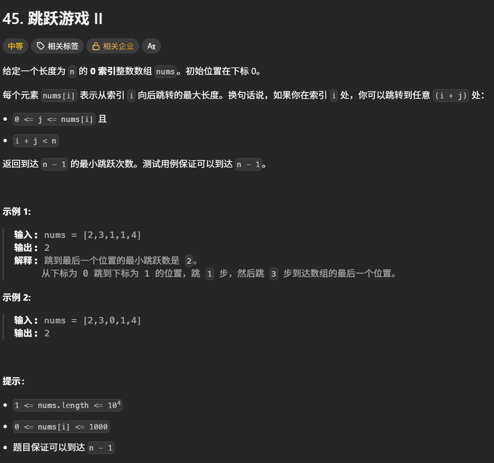
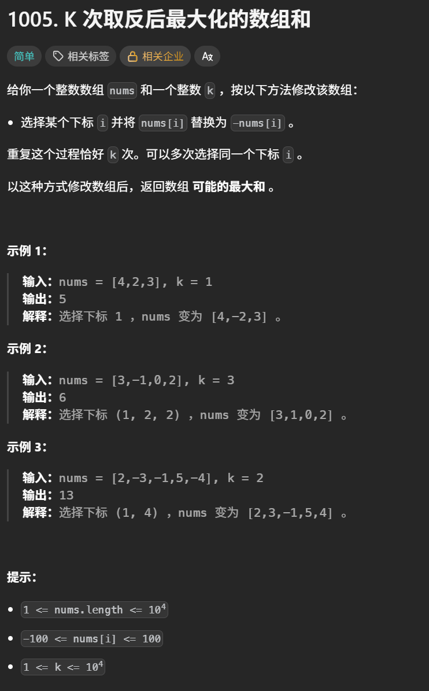
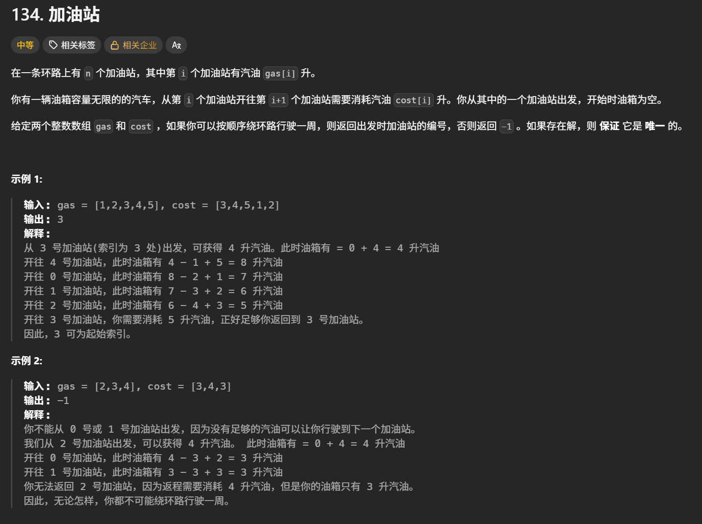
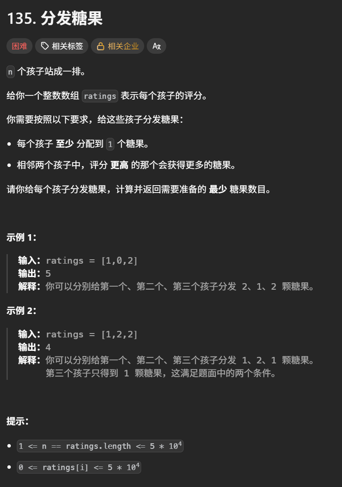
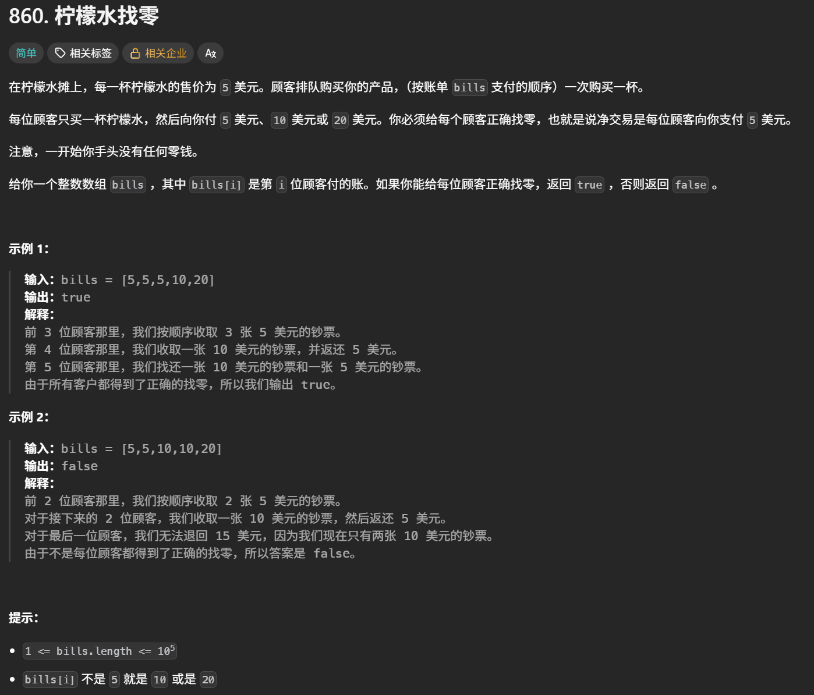
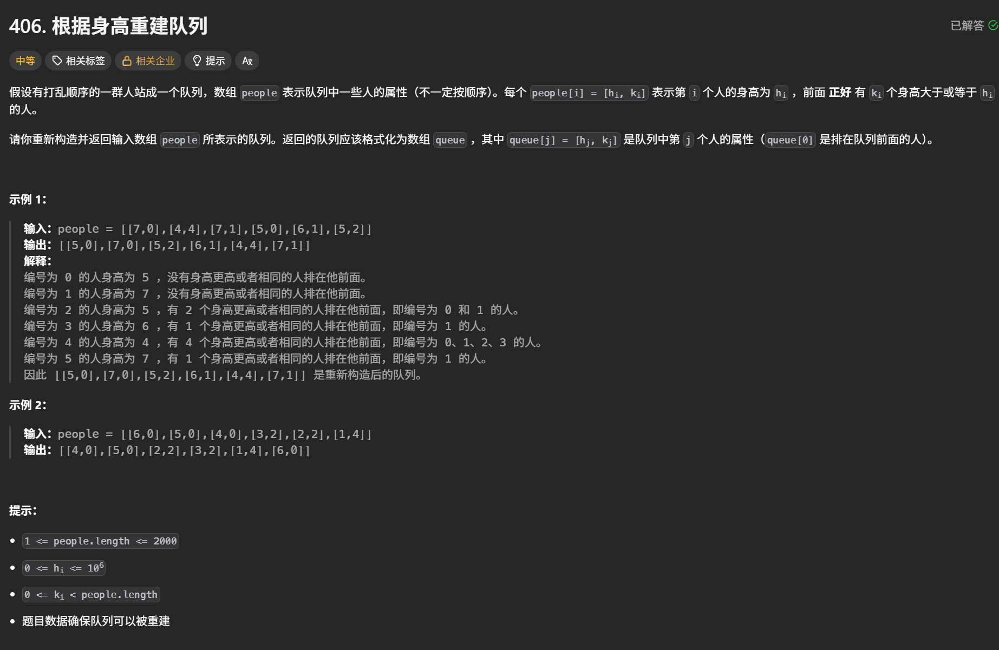
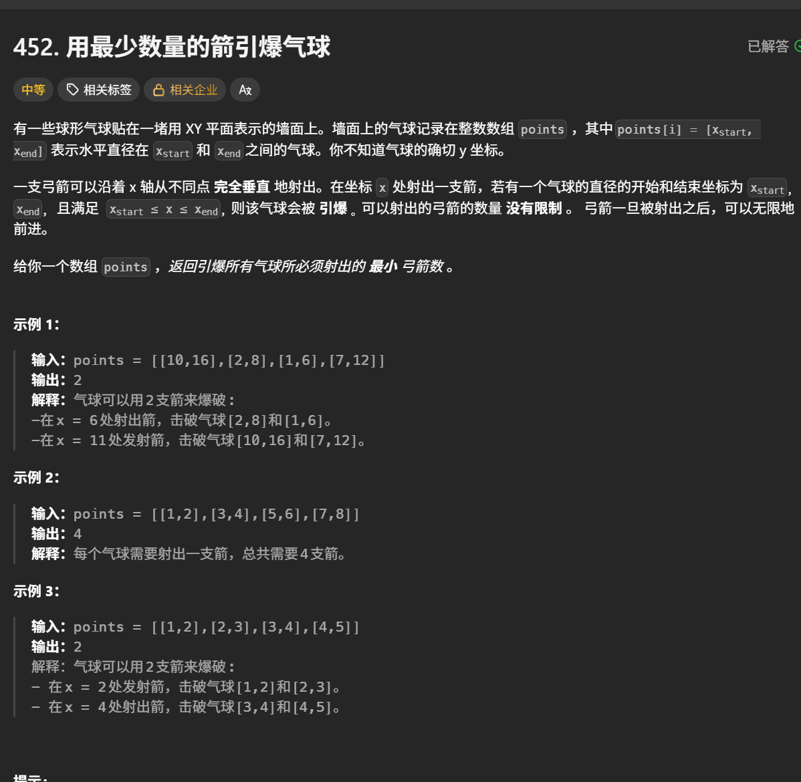
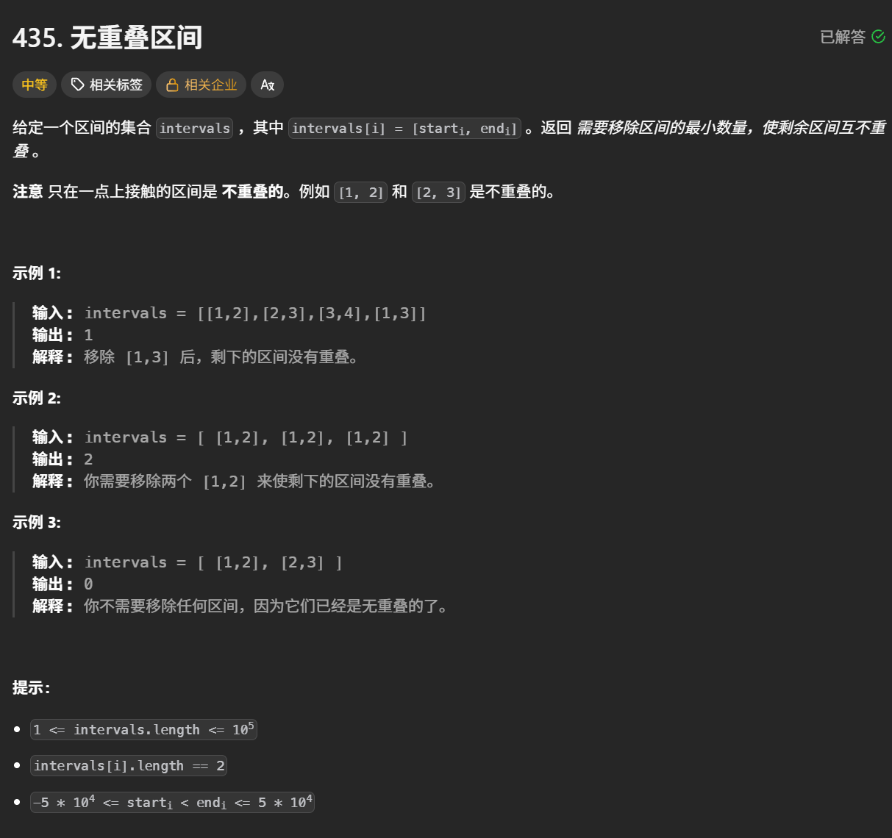
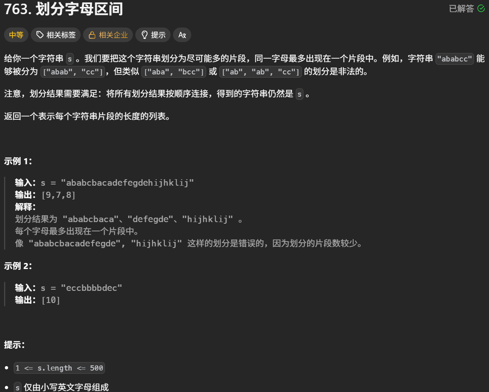
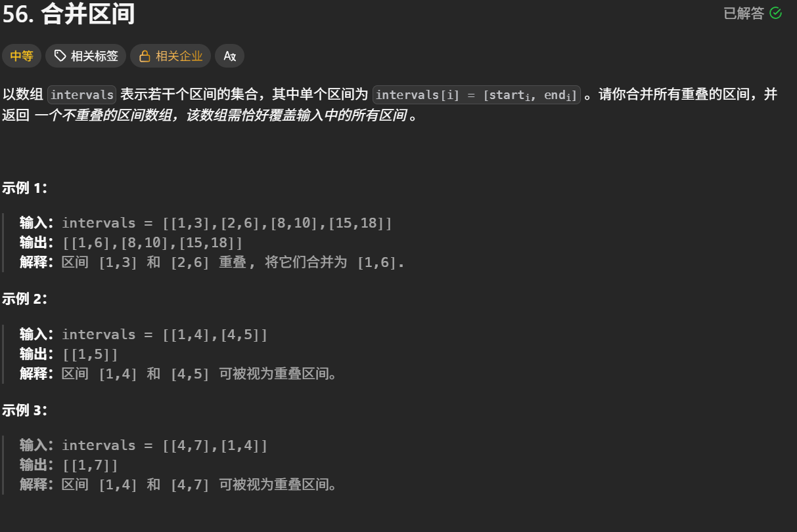

# 贪心算法学习心得

本目录用于保存贪心算法专题的实现代码，并记录局部选择策略、正确性分析、易错点、边界条件和个人复盘。

## 学习内容

- [x] 贪心算法基础与适用条件
- [x] 分配问题（分发饼干、分发糖果等）
- [ ] 序列问题（摆动序列、最大子数组和等）
- [ ] 跳跃游戏与覆盖范围
- [ ] 区间问题（无重叠区间、合并区间等）
- [ ] 排序策略与多条件处理
- [ ] 贪心策略的正确性与反例分析
- [ ] 贪心算法综合复盘

## 核心思路

- 先明确全局目标，再提出每一步的局部选择，并说明它为什么不会排除最优解。
- 根据题目选择排序、单次遍历或多次遍历；先确定排序依据，再决定如何更新状态。
- 用交换论证、归纳或边界分析验证策略；尝试构造反例，避免仅凭几个样例判断正确。
- 如果当前选择会影响后续且无法证明贪心成立，应重新分析问题，考虑动态规划或回溯等方法。

## 易错点与边界条件

- **局部最优不一定导向全局最优**：写清当前选择保留了哪些后续可能，以及正确性成立的前提。
- **排序规则**：明确升序、降序及相等时的处理方式；同时关注多个条件时，考虑是否需要分阶段处理。
- **区间端点**：明确端点相等时算重叠还是可衔接，统一使用 `<` 或 `<=`。
- **状态更新**：区分当前可达范围、下一步可达范围、累计结果与最终答案，避免提前更新导致重复统计。
- **边界检查**：按题目约束检查单元素、重复值、全负数、无法到达目标、恰好达到边界及空输入等情况。

## 复盘

> 后续根据每道题的注释和笔记，总结局部选择、全局目标、正确性依据、排序与边界处理，以及实际遇到的问题。

## 代码记录

#### 分发饼干

[分发饼干](https://leetcode.cn/problems/assign-cookies/description/)


```python
class Solution:
    def findContentChildren(self, g: List[int], s: List[int]) -> int:
        #先进行排序，从小到大
        g.sort()
        s.sort()
        #全局最优，可以满足胃口数量
        result = 0
        #饼干从最大的开始
        index_s = len(s) - 1
        #胃口也从最大的开始
        for i in range(len(g) - 1 , -1 , -1):#range(起始值, 结束值, 步长)。第二个-1是遍历在到达 -1 前停止，因此最后取到的是 0。第三个-1是步长为 -1，表示每次下标减 1，即倒序遍历
            if index_s >= 0 and s[index_s] >= g[i]:
                result += 1
                index_s -= 1
        return result
```

#### 摆动序列

[摆动序列](https://leetcode.cn/problems/wiggle-subsequence/description/)


```python
class Solution:
    def wiggleMaxLength(self, nums: list[int]) -> int:
        if len(nums) <= 1:
            return len(nums)
        cur_dif = 0
        pre_dif = 0
        result = 1 #默认序列最右边有一个峰值
        for i in range(len(nums) - 1):
            cur_dif = nums[i + 1] - nums[i]
            ##出现峰值
            if (pre_dif <= 0 and cur_dif > 0) or (pre_dif >= 0 and cur_dif < 0):
                result += 1
                pre_dif = cur_dif#只有发现新的摆动方向时才更新
        return result
```

#### 最大子数组和

[最大子数组和](https://leetcode.cn/problems/maximum-subarray/description/)


```python
class Solution:
    def maxSubArray(self, nums: list[int]) -> int:
        result = float('-inf')#初始化为负无穷大
        count = 0#记录区间的和
        for i in range(len(nums)):
            count += nums[i]
            if count >= result:
                result = count
            if count <=0:
                count = 0
        return result
```

#### 买卖股票的最佳时机Ⅱ

[买卖股票的最佳时机Ⅱ](https://leetcode.cn/problems/best-time-to-buy-and-sell-stock-ii/description/)


```python
class Solution:
    def maxProfit(self, prices: list[int]) -> int:
        #只需要统计每天正利润就可以
        result = 0
        for i in range(1 , len(prices)):
            result += max(prices[i] - prices[i - 1] , 0)
        return result
```

#### 跳跃游戏

[跳跃游戏](https://leetcode.cn/problems/jump-game/description/)


```python
class Solution:
    def canJump(self, nums: list[int]) -> bool:
        #只要能覆盖最后一个元素，就一定可以跳到最后一个元素
        cover = 0#覆盖范围
        if len(nums) == 1:return True
        # python不支持动态修改for循环中变量,使用while循环代替
        i = 0
        while i <= cover:
            cover = max(nums[i] + i , cover)
            i += 1
            if cover >= len(nums) - 1:return True
        return False
```

#### 跳跃游戏Ⅱ

[跳跃游戏Ⅱ](https://leetcode.cn/problems/jump-game-ii/description/)



```python
class Solution:
    def jump(self, nums: list[int]) -> int:
        #以最小的步数增加最大的覆盖范围，直到覆盖范围覆盖了终点
        if len(nums) == 1:
            return 0
        next_distance = 0#下一次最大能到达的下标
        cur_distance = 0#当前最大能达到的下标
        step = 0#跳数
        for i in range(len(nums)):
            next_distance = max(nums[i] + i , next_distance)
            if i == cur_distance:
                step += 1
                cur_distance = next_distance
                if next_distance >= len(nums) - 1:
                    break
        return step
```

#### K次取反后最大化的数组和

[K次取反后最大化的数组和](https://leetcode.cn/problems/maximize-sum-of-array-after-k-negations/description/)



```python
class Solution:
    def largestSumAfterKNegations(self, nums: List[int], k: int) -> int:
        nums.sort(key = lambda x : abs(x) , reverse = True)#将nums里的元素按照绝对值大小从大到小排列
        #取k次翻转
        for i in range(len(nums)):
            if nums[i] < 0 and k > 0:
                nums[i] *= -1
                k -= 1
        if k % 2 == 1:#如果还有剩余次数，就把最小的元素翻转
            nums[-1] *= -1
        #求和
        result = sum(nums)
        return result
```

#### 加油站

[加油站](https://leetcode.cn/problems/gas-station/description/)



```python
class Solution:
    def canCompleteCircuit(self, gas: list[int], cost: list[int]) -> int:
        resSUm = 0
        totalSum = 0
        start = 0
        for i in range(len(gas)):
            resSUm += gas[i] - cost[i]
            totalSum += gas[i] - cost[i]
            if resSUm < 0:
                start = i + 1
                resSUm = 0
        if totalSum < 0 :
            return -1
        return start
```

#### 分发糖果

[分发糖果](https://leetcode.cn/problems/candy/description/)



```python
class Solution:
    def candy(self, ratings: List[int]) -> int:
        sums = [1]  * len(ratings)
        #右大于左的情况
        for i in range(1 , len(ratings)):
            if ratings[i] > ratings[i - 1]:
                sums[i] = sums[i - 1] + 1
        #左大于右的情况
        for i in range(len(ratings) - 2 , -1 , -1):
            if ratings[i] > ratings[i+1]:
                sums[i] = max(sums[i+1]+1, sums[i])
        return sum(sums)
```

#### 柠檬水找零

[柠檬水找零](https://leetcode.cn/problems/lemonade-change/description/)



```python
class Solution:
    def lemonadeChange(self, bills: List[int]) -> bool:
        five = 0
        ten = 0
        twenty = 0
        for bill in bills:
            if bill == 5:
                five += 1
            if bill == 10:
                if five > 0:
                    five -= 1
                    ten += 1
                else :
                    return False
            if bill == 20:
                if five > 0 and ten > 0:
                    five -= 1
                    ten -= 1
                    twenty += 1
                elif five >= 3:
                    five -= 3
                    twenty += 1
                else:
                    return False
        return True
```

#### 根据身高重建队列

[根据身高重建队列](https://leetcode.cn/problems/queue-reconstruction-by-height/)



```python
class Solution:
    def reconstructQueue(self, people: List[List[int]]) -> List[List[int]]:
        #**对当前的人：**已经入队的人都比他高，或者和他一样高。因此，把他插入下标 k，前面就恰好有 k 个身高不低于他的人。
        #**对已经入队的人：**后来插入的矮个子，即使站在他们前面，也不会增加他们前面“身高大于或等于自己”的人数，所以不会破坏已有条件。同身高的人按照 k 从小到大处理，后处理的人会插在此前同身高的人后面。
        #先按照h维度的身高顺序从高到低排序。确定第一个维度
        people.sort(key = lambda x : (-x[0] , x[1]))#-x[0]表示h维度从大到小排序，x[1]表示h相同时，k小的排在前面
        que = []
        #根据每个元素的第二个维度k，贪心算法，进行插入
        for p in people:
            #按照k进行插入
            que.insert(p[1] , p)#把p插入到p[1]的位置
        return que
```

#### 用最少数量的箭引爆气球

[用最少数量的箭引爆气球](https://leetcode.cn/problems/minimum-number-of-arrows-to-burst-balloons/)



```python
class Solution:
    def findMinArrowShots(self, points: List[List[int]]) -> int:
        if len(points) ==  0 : return 0
        #按照左边界进行从小到大排序
        points.sort(key = lambda x : x[0])
        result = 1 #气球不为空的时候，最少需要一支箭
        for i in range(1 , len(points)):
            #如果两个气球不重叠
            if points[i][0] > points[i-1][1]:
                result += 1
            else:#气球重叠的话
            #更新最小右边界
                points[i][1] = min(points[i-1][1] , points[i][1])

        return result

```

#### 无重叠区间

[无重叠区间](https://leetcode.cn/problems/non-overlapping-intervals/description/)



```python
class Solution:
    def eraseOverlapIntervals(self, intervals: List[List[int]]) -> int:
        if not intervals:
            return 0
        #按照左边界进行升序排序
        intervals.sort(key = lambda x : x[0])
        #记录重叠个数
        count = 0
        for i in range(1 , len(intervals)):
            if intervals[i][0] < intervals[i - 1][1]:#当前区间的左边界小于上一个区间的右边界，说明有重叠
                count += 1
                intervals[i][1] = min(intervals[i][1] , intervals[i-1][1])#更新最小右边界
        return count

```

#### 划分字母区间

[划分字母区间](https://leetcode.cn/problems/partition-labels/submissions/756962589/)



```py
class Solution:
    def partitionLabels(self, s: str) -> list[int]:
        #找到每种字符最后出现的位置下标
        last = {}
        for i , ch in enumerate(s):
            last[ch] = i
        #再遍历s字符串，当前字符的下标等于最后出现位置的下标时，就可以进行切割
        result = []
        #切割区间的起始位置下标
        start , end = 0 , 0
        for i , ch in enumerate(s):
            end = max(end , last[ch])#当前字符出现的最远距离
            if i == end:
                result.append(end - start + 1)
                start = end + 1
        return result
```

#### 合并区间

[合并区间](https://leetcode.cn/problems/merge-intervals/description/)



```python
class Solution:
    def merge(self, intervals: list[list[int]]) -> list[list[int]]:
        result = []
        if not intervals:
            return result
        #按照左边界进行升序排序
        intervals.sort(key = lambda x : x[0])
        #第一个数组加到result中
        result.append(intervals[0])
        #如果当前区间的左边界小于上一个区间的右边界，就有重叠
        for i in range(1 , len(intervals)):
            if result[-1][1] >= intervals[i][0]:
                result[-1][1] = max(result[-1][1] , intervals[i][1])
            else:
                result.append(intervals[i])
        return result
```
