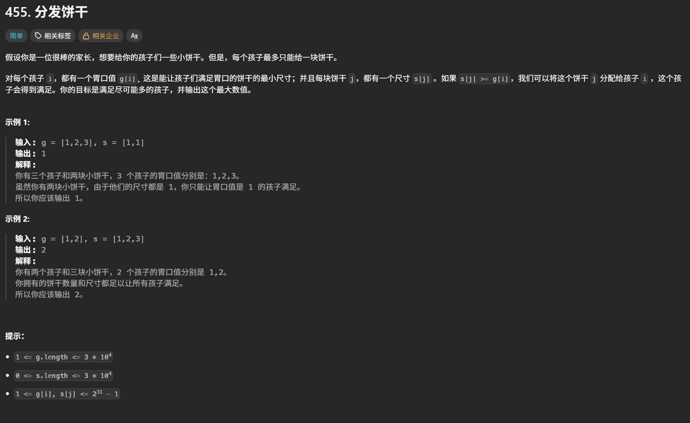
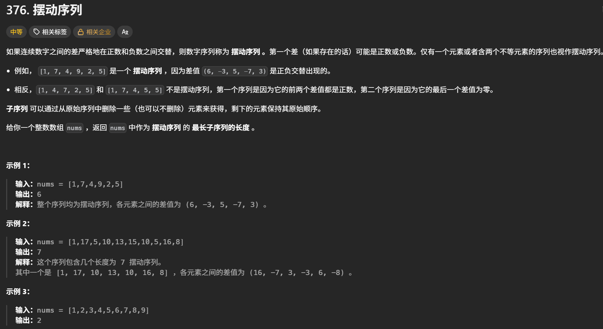
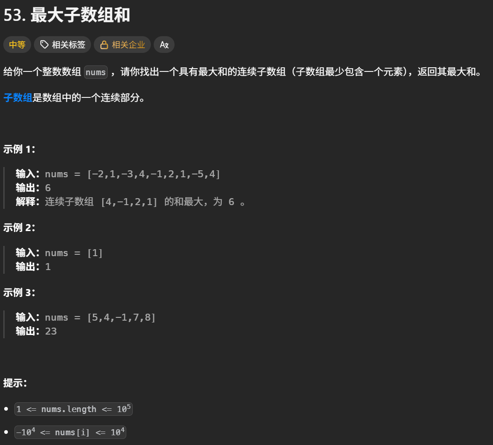
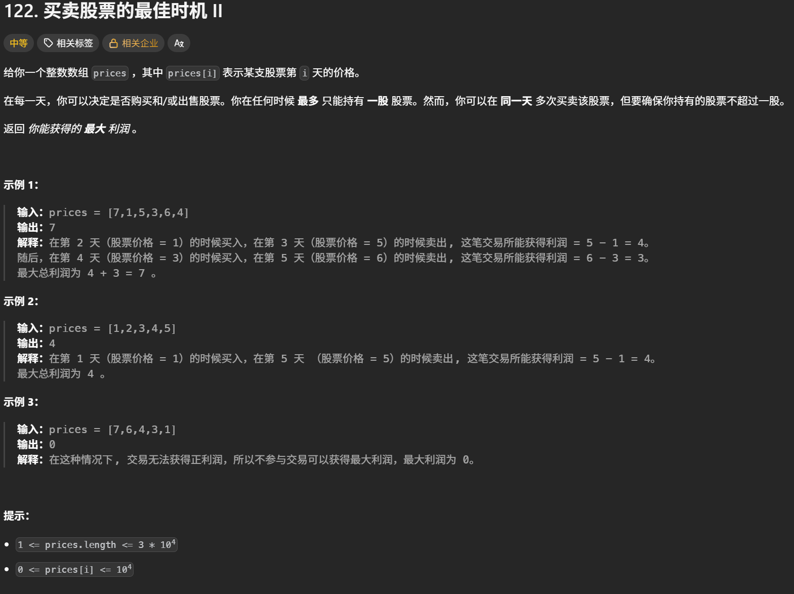
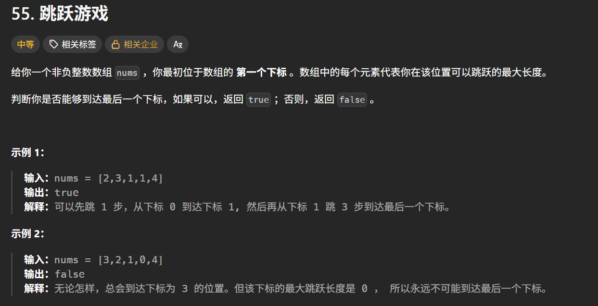

# 贪心算法学习心得

本目录用于保存贪心算法专题的实现代码，并记录局部选择策略、正确性分析、易错点、边界条件和个人复盘。

## 学习内容

- [x] 贪心算法基础与适用条件
- [x] 分配问题（分发饼干、分发糖果等）
- [ ] 序列问题（摆动序列、最大子数组和等）
- [ ] 跳跃游戏与覆盖范围
- [ ] 区间问题（无重叠区间、合并区间等）
- [ ] 排序策略与多条件处理
- [ ] 贪心策略的正确性与反例分析
- [ ] 贪心算法综合复盘

## 核心思路

- 先明确全局目标，再提出每一步的局部选择，并说明它为什么不会排除最优解。
- 根据题目选择排序、单次遍历或多次遍历；先确定排序依据，再决定如何更新状态。
- 用交换论证、归纳或边界分析验证策略；尝试构造反例，避免仅凭几个样例判断正确。
- 如果当前选择会影响后续且无法证明贪心成立，应重新分析问题，考虑动态规划或回溯等方法。

## 易错点与边界条件

- **局部最优不一定导向全局最优**：写清当前选择保留了哪些后续可能，以及正确性成立的前提。
- **排序规则**：明确升序、降序及相等时的处理方式；同时关注多个条件时，考虑是否需要分阶段处理。
- **区间端点**：明确端点相等时算重叠还是可衔接，统一使用 `<` 或 `<=`。
- **状态更新**：区分当前可达范围、下一步可达范围、累计结果与最终答案，避免提前更新导致重复统计。
- **边界检查**：按题目约束检查单元素、重复值、全负数、无法到达目标、恰好达到边界及空输入等情况。

## 复盘

> 后续根据每道题的注释和笔记，总结局部选择、全局目标、正确性依据、排序与边界处理，以及实际遇到的问题。

## 代码记录

#### 分发饼干

[分发饼干](https://leetcode.cn/problems/assign-cookies/description/)



```python
class Solution:
    def findContentChildren(self, g: List[int], s: List[int]) -> int:
        #先进行排序，从小到大
        g.sort()
        s.sort()
        #全局最优，可以满足胃口数量
        result = 0
        #饼干从最大的开始
        index_s = len(s) - 1
        #胃口也从最大的开始
        for i in range(len(g) - 1 , -1 , -1):#range(起始值, 结束值, 步长)。第二个-1是遍历在到达 -1 前停止，因此最后取到的是 0。第三个-1是步长为 -1，表示每次下标减 1，即倒序遍历
            if index_s >= 0 and s[index_s] >= g[i]:
                result += 1
                index_s -= 1
        return result
```

#### 摆动序列

[摆动序列](https://leetcode.cn/problems/wiggle-subsequence/description/)



```python
class Solution:
    def wiggleMaxLength(self, nums: list[int]) -> int:
        if len(nums) <= 1:
            return len(nums)
        cur_dif = 0
        pre_dif = 0
        result = 1 #默认序列最右边有一个峰值
        for i in range(len(nums) - 1):
            cur_dif = nums[i + 1] - nums[i]
            ##出现峰值
            if (pre_dif <= 0 and cur_dif > 0) or (pre_dif >= 0 and cur_dif < 0):
                result += 1
                pre_dif = cur_dif#只有发现新的摆动方向时才更新
        return result
```

#### 最大子数组和

[最大子数组和](https://leetcode.cn/problems/maximum-subarray/description/)



```python
class Solution:
    def maxSubArray(self, nums: list[int]) -> int:
        result = float('-inf')#初始化为负无穷大
        count = 0#记录区间的和
        for i in range(len(nums)):
            count += nums[i]
            if count >= result:
                result = count
            if count <=0:
                count = 0
        return result
```

#### 买卖股票的最佳时机Ⅱ

[买卖股票的最佳时机Ⅱ](https://leetcode.cn/problems/best-time-to-buy-and-sell-stock-ii/description/)



```python
class Solution:
    def maxProfit(self, prices: list[int]) -> int:
        #只需要统计每天正利润就可以
        result = 0
        for i in range(1 , len(prices)):
            result += max(prices[i] - prices[i - 1] , 0)
        return result
```

#### 跳跃游戏

[跳跃游戏](https://leetcode.cn/problems/jump-game/description/)



```python
class Solution:
    def canJump(self, nums: list[int]) -> bool:
        #只要能覆盖最后一个元素，就一定可以跳到最后一个元素
        cover = 0#覆盖范围
        if len(nums) == 1:return True
        # python不支持动态修改for循环中变量,使用while循环代替
        i = 0
        while i <= cover:
            cover = max(nums[i] + i , cover)
            i += 1
            if cover >= len(nums) - 1:return True
        return False
```
